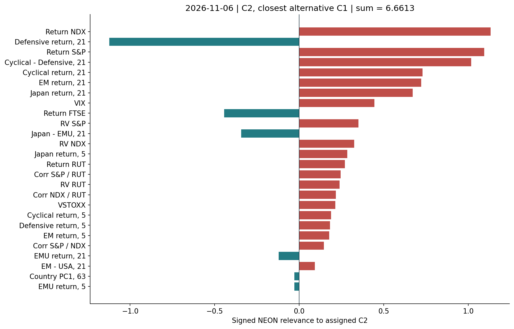

# ECCLES v1.0

**Adopted model: frozen Global26 KMeans + direct NEON/LRP.** Each complete US session receives C0, C1 or C2 from its nearest frozen center. The API returns the decision, closest competing regime, distances, signed feature contributions and English/Korean interpretation.

Training: 2001-2022, 5,391 complete dates. Previously examined validation: 2023-2024, 490 dates. The release replay also covers 209 examined 2026 dates through November 5. Model export preserves all **6,090/6,090 assignments** and NEON contributions, with zero refits.

**Deployment:** The company-server API and daily timer are active. All 18 server checks pass. Original-source refresh and authenticated API responses are verified. [Verified deployment state](docs/DEPLOYMENT.md).

| Read | Content |
| --- | --- |
| [English model report](docs/v1.0/model-report.md) | Construction, sources, evidence, interpretation and all 26 feature graphs |
| [Korean model report](docs/v1.0/model-report-ko.md) | Same report in Korean |
| [Korean PDF](docs/v1.0/output/pdf/model-report-ko.pdf) | Two-column report with chart explanations |
| [English HTML](docs/v1.0/model-report.html), [Korean HTML](docs/v1.0/model-report-ko.html) | Download and open locally, with the adjacent figures directory |
| [API and operations](docs/API.md) | Authentication, data status, scheduled refresh, activation and rollback |
| [Version policy](docs/VERSIONING.md) | Model v1.0, v1.1 and v2.0 rules, separate service versions |
| [Exact bundle](models/1.0/model.json) | Ordered sources, formulas, scalers, weights, centers, labels and beta |
| [Validation evidence](docs/validation/replay.json) | Historical reproduction, tolerances and denominators |

## Release observation

As collected on November 10, 2026, the latest complete observation is **November 6: C2, weak/stressed**, with **C1** the closest alternative. The official Cboe daily VIX file ends November 6 while the other 17 sources include November 9. The service retains November 6 and reports November 9 `missing_inputs`. Query the API for subsequent live updates; this README is a dated release snapshot.

NEON support comes from weak Nasdaq/S&P returns and Cyclical-Defensive leadership. Defensive21 (+6.55%) and FTSE21 (+2.23%) oppose C2. Margin is 6.6613, at the 61.0th percentile of training C2 margins. Training C2 distance percentile is 85.6. See the report for every contribution and raw value.



## Model contents

Six original series produce 12 core rank features: four equity returns, five volatility measures and three US co-movement measures. Twelve original MSCI USD STRD price indices produce four relative/structure ranks and ten actual 5/21-session returns. All 26 coordinates enter one joint weighted KMeans distance.

Source selection is explicit: FMP S&P 500, Nasdaq 100 and FTSE 100; Yahoo original Russell 2000; Cboe VIX; STOXX V2TX; MSCI World Cyclical, World Defensive, USA, UK, Japan, Canada, Australia, Germany, France, Switzerland, EM and EMU. No ETF substitution or local price imputation.

Since v1.0.1 the official Cboe VIX file, which publishes next morning US time, may be extended past its last date with the identical close from FMP `^VIX`: the fallback is accepted only when both channels agree within 0.005 on at least three overlapping dates, the added dates and the fallback response hash are recorded in the run's `sources.json`, and the next official file supersedes it (any divergence surfaces as a recorded revision). Values are never estimated.

NEON explains the exact frozen decision. Positive feature relevance supports the assigned regime, negative relevance opposes it, and the signed total equals the winning margin. B12 and XGBoost comparisons remain in the original research archive.

## Run locally

Python 3.12, one numerical thread. Keep secrets outside Git.

```bash
python3.12 -m venv .venv
.venv/bin/pip install -r requirements.lock
.venv/bin/pip install --no-deps -e .
export OMP_NUM_THREADS=1 OPENBLAS_NUM_THREADS=1 MKL_NUM_THREADS=1 NUMEXPR_NUM_THREADS=1
export ECCLES_MODELS="$PWD/models" ECCLES_RUNTIME="$PWD/runtime"
# Set FMP_API_KEY and ECCLES_API_KEY securely in the process environment.
.venv/bin/eccles validate 1.0
.venv/bin/eccles activate 1.0
.venv/bin/eccles refresh
.venv/bin/uvicorn eccles_service.api:create_app --factory --host 127.0.0.1 --port 18771 --workers 1 --no-access-log
```

The API refuses startup without a token of at least 32 characters. The unauthenticated `/health/live` endpoint only returns process liveness. Informative endpoints require Bearer authentication. Missing or stale data remains explicit even when an older valid record is returned.

## Repository boundary

This private repository contains the frozen portable bundle, derived training references, golden examples, service source, tests, release report and deployment templates. Raw vendor histories, proprietary HSBC documents/photos, credentials, live snapshots and SQLite records stay outside Git. The full historical research runs remain in the original ECCLES workspace.

The model is immutable within a version. Supported recipe changes can be delivered as a new model bundle; new feature operators require a compatible engine update. See [VERSIONING](docs/VERSIONING.md).
