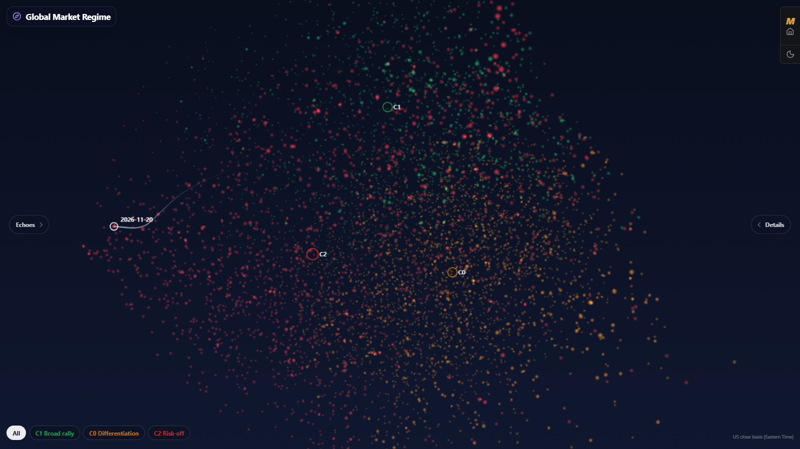
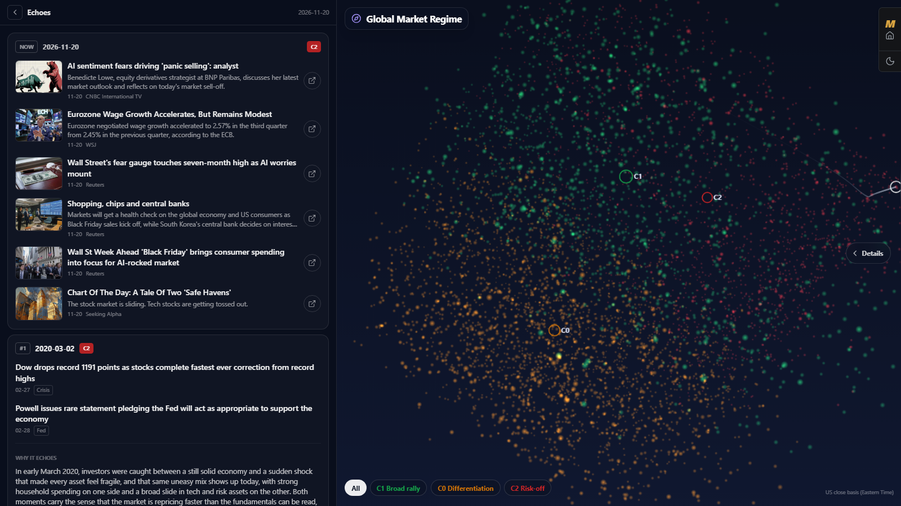
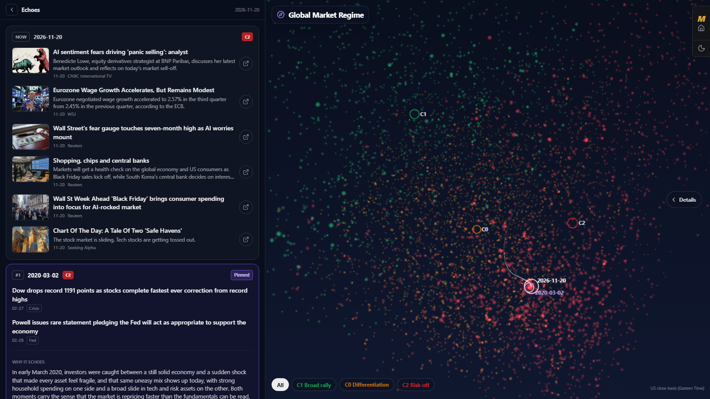

# Global Market Regime UI

ECCLES v1.0 (Global26) API를 소비하는 MIDAS 플랫폼 메뉴 "글로벌 시장 레짐"의 프론트 기능 정리입니다.

- 경로: `/midas_one/global-regime` (LIVE 9001, TEST 18001)
- 소스: midas_platform 리포의 `frontend/app/global-regime/page.tsx` + `backend/app/api/global_regime.py` (ECCLES API 프록시, 이 리포에는 포함되지 않음)
- 모든 화면 표시는 영어, 판정 기준은 미국 종가(US close basis, Eastern Time)
- 아래 스크린샷은 2026-11-23 LIVE 캡처 기준

## 화면 구조

진입하면 3D 레짐 공간만 보이고, 우측 Details 버튼(또는 휠 스크롤)으로 대시보드가, 좌측 Echoes 버튼으로 유사 국면 패널이 슬라이드로 열립니다. 양쪽을 동시에 열면 3D 무대가 가운데로 줄어들며, Esc로 모두 닫습니다.

## 1. 3D 레짐 공간 (히어로)

- 일별 26개 입력(학습 백분위)을 PCA 3축으로 투영한 점구름 약 5,900일. 라이브러리 없이 캔버스 직접 렌더(가산 블렌딩 글로우)
- 점 색은 레짐: C1 Broad rally(녹색), C0 Differentiation(주황), C2 Risk-off, stress(적색). 학습 구간(2001~2022)은 연하게
- 최신 판정일은 흰 링 + 날짜 라벨, 최근 5거래일은 곡선 꼬리로 연결
- 자동 회전, 드래그 회전, 하단 칩으로 레짐별 점 필터
- 데이터는 정적 json(분기 1회 재생성) + `/vectors-recent`로 파일 이후 날짜를 같은 PCA 축에 즉석 투영해 덧붙임. 그래서 당일 판정이 발행되면 재생성 없이 점이 생깁니다

## 2. Details 대시보드: 판정과 기여도

- 판정 카드: 현재 레짐, 확신도(High/Medium/Low), 대안 레짐(Alt, 판정이 바뀐다면 이쪽), 레짐별 학습 중심 근접 막대(현재 판정 = 100%), Clarity 배지. 근거 수치는 전부 툴팁으로만
- Contribution breakdown: NEON 기여도 26개 입력 전체를 누적(waterfall) 화살표로 분해. 지지 입력은 레짐색, 반대는 회색, 합계가 판정 여유
- 차트에서 과거 날짜를 클릭하면 이 패널 전체가 그 날짜 기준으로 전환됩니다(과거 판정 리플레이)

## 3. 지수 차트와 레짐 오버레이

- NASDAQ-100 / S&P 500 / Russell 2000 선택, 선택 지수 위에 일별 레짐 점
- 범위 6M/1Y/3Y/5Y/10Y/Max(2001년부터), 장기 구간은 로그 축 자동, 휠 줌 + 드래그 패닝
- 날짜 클릭 = 핀: 판정 카드, 기여도, 3D 발광이 모두 그 날짜로 고정
- 하단 Data(마지막 런, 소스 날짜 18종), Model(Global26 v1.0, 26 inputs, 학습 2001~2022) 접이식. "Not a forecast" 명시

## 4. Echoes: 오늘의 뉴스와 유사 과거 국면

- NOW 카드: 오늘(미국 기준 최근 거래일)의 시장 헤드라인. FMP 뉴스를 하루 1회 자동 적재(첫 열람이 수집 트리거)하며 썸네일, 2줄 요약, 원문 링크 버튼
- 유사 과거 3일: 오늘의 26개 입력을 PCA 공간에서 최근접 탐색(최근 120일 제외, 에피소드 45일 분리)한 상위 3개 과거 날짜. 각 카드에 그 주간의 헤드라인(아카이브), 레짐 경로, 지수 주간 수익률
- WHY IT ECHOES: 오늘 헤드라인과 그때 헤드라인을 Claude가 비교해 두 시점이 공유하는 투자 심리와 그 에피소드의 교훈을 2~3문장으로 서술. 화면에 보이는 헤드라인만 근거로 쓰며, 결과는 캐시되어 유사일당 1회만 생성
- 헤드라인 아카이브: 2001~2025 큐레이션 853건(날짜 검증된 주요 사건, 위키피디아 링크 포함) + 2017년 이후 GDELT 주별 실기사 백필(진행 중) + 2026-11-18부터 FMP 일일 적재

## 5. 동시 열람

좌측 Echoes와 우측 대시보드를 함께 열어 "오늘 뉴스, 유사 국면, 판정 근거, 가격"을 한 화면에서 봅니다.

## 6. 유사일 핀과 3D 발광

유사일 카드를 클릭하면 그 날짜가 핀 되고 3D 점구름에서 해당 점이 발광합니다. 위 캡처는 오늘(2026-11-20) 점 바로 옆에서 1위 유사일 2020-03-02가 빛나는 장면으로, 두 시점이 레짐 공간에서 실제로 이웃임을 보여줍니다.

## 데이터 흐름

| 백엔드 엔드포인트 | 내용 | 원천 |
|---|---|---|
| `/api/global-regime/latest` | 당일 판정 | ECCLES `/v1/regime/latest` |
| `/api/global-regime/history` | 2001~ 일별 레짐(연 단위 분할 수집, 캐시) | ECCLES `/v1/regimes` |
| `/api/global-regime/detail/{date}` | 특정일 NEON 26개 기여도 | ECCLES |
| `/api/global-regime/archive` | 2024-10~2026-11 일별 전지표 재현 | 서버 재현 아카이브 json |
| `/api/global-regime/nasdaq` | NDX/SPX/RUT 종가(2001~, 4년 분할) | FMP |
| `/api/global-regime/vectors-recent` | 3D 덧붙임용 최근 입력 백분위 | ECCLES |
| `/api/global-regime/headlines` | 일일 뉴스 적재 + 최근 21일 | FMP stable news |
| `/api/global-regime/echo-analysis` | WHY IT ECHOES 비교 문장 | agent hub Claude 런너(구독, 캐시) |

- ECCLES 판정 발행: eccles-refresh.timer 월~토 07:20 / 09:20 / 10:40 / 12:20 / 16:20 KST (보통 10:40에 당일 판정)
- 느린 원천은 전부 백엔드 캐시 + 기동 예열 스레드로 흡수(콜드 17초대였던 history가 웜 1초 미만)
- 런너나 뉴스 수집이 실패해도 메뉴는 폴백(기술 문장, 캐시분)으로 동작합니다
