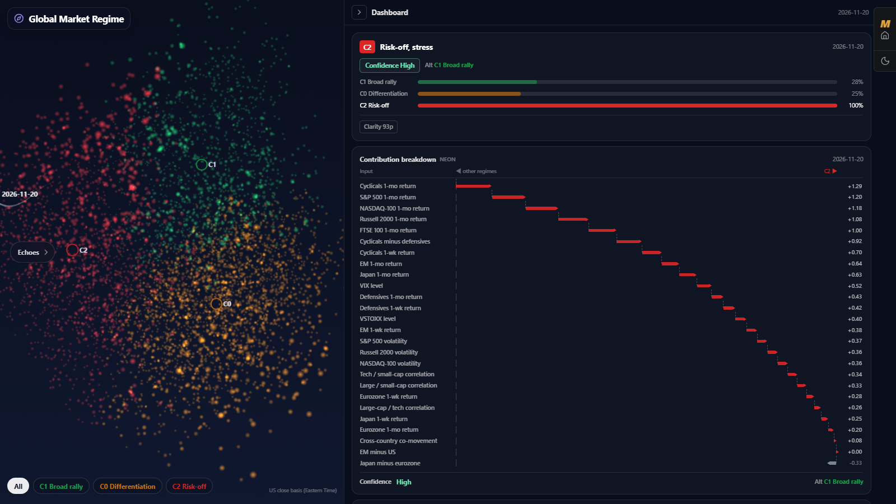
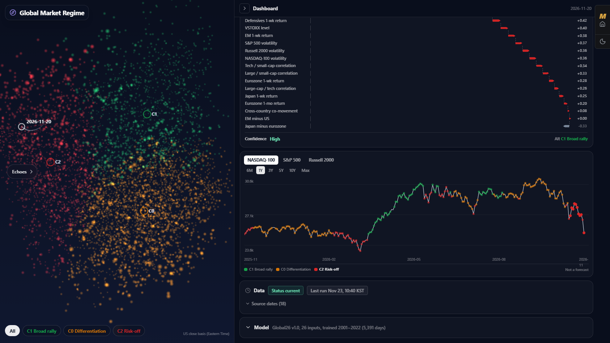
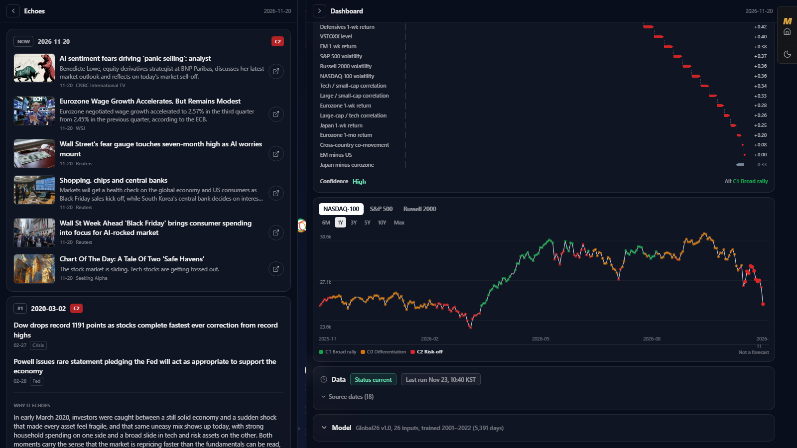

# Global Market Regime UI

Frontend guide for the MIDAS platform menu "Global Market Regime", the consumer of the ECCLES v1.0 (Global26) API.

- Route: `/midas_one/global-regime` (LIVE 9001, TEST 18001)
- Source: `frontend/app/global-regime/page.tsx` + `backend/app/api/global_regime.py` (ECCLES API proxy) in the midas_platform repository, not included here
- All on-screen text is English; regime calls are on a US close basis (Eastern Time)
- Screenshots below captured from LIVE on 2026-11-23

## Screen layout

The page opens with the 3D regime space in full screen. The Details button on the right (or wheel scroll) slides in the dashboard, and the Echoes button on the left slides in the historical-analog panel. With both open, the 3D stage shrinks to the center. Esc closes everything.

## 1. 3D regime space (hero)

- Roughly 5,900 trading days, each day's 26 inputs (training-window percentiles) projected onto 3 PCA axes. Rendered directly on canvas with additive-blending glow, no chart library
- Point color is the regime: C1 Broad rally (green), C0 Differentiation (orange), C2 Risk-off, stress (red). The training window (2001~2022) is dimmed
- The latest call is marked with a white ring and date label; the last 5 trading days are joined by a curved tail
- Auto rotation, drag to rotate, bottom chips filter points by regime
- Data is a static json (regenerated quarterly) plus `/vectors-recent`, which projects dates newer than the file onto the same PCA axes on the fly, so the point for today's call appears without regeneration

## 2. Details dashboard: the call and its drivers

- Call card: current regime, confidence (High/Medium/Low), the alternative regime (Alt, where the call would flip), per-regime proximity bars against the training centroids (current call = 100%), and a Clarity badge. All underlying numbers live in tooltips only
- Contribution breakdown: all 26 NEON input contributions decomposed as a cumulative waterfall of arrows. Supporting inputs take the regime color, opposing inputs are gray; the sum is the call's margin
- Clicking a past date on the chart switches this whole panel to that date (replay of a historical call)

## 3. Index chart with regime overlay

- NASDAQ-100 / S&P 500 / Russell 2000 selector, with daily regime dots drawn on the selected index
- Ranges 6M/1Y/3Y/5Y/10Y/Max (back to 2001), automatic log scale on long ranges, wheel zoom and drag panning
- Clicking a date pins it: the call card, the contributions, and the 3D glow all lock to that date
- Collapsible Data (last run, 18 source dates) and Model (Global26 v1.0, 26 inputs, trained 2001~2022) sections at the bottom. "Not a forecast" is stated explicitly

## 4. Echoes: today's news and similar past weeks

- NOW card: market headlines for today (latest US trading day). FMP news is ingested once a day (first view triggers collection), with thumbnail, 2-line summary, and a link to the original article
- Top 3 analogs: ranked 60% by today's position in PCA space and 40% by the shape of the last 10 trading days' path (excluding the last 120 days, with 45-day episode separation). Each card shows that week's headlines from the archive and the regime path. Post-date returns were removed on 2026-11-24 after a 20-year backtest showed analog forward returns carry no predictive power
- WHY IT ECHOES: Claude compares today's headlines with that week's headlines and writes 2~3 sentences on the investor psychology the two moments share and the lesson of that episode. It only uses headlines visible on screen, and the result is cached so it is generated once per analog
- Headline archive: 1,716 entries — 853 curated 2001~2025 (date-verified major events, with Wikipedia links) plus a GDELT weekly backfill of real articles 2017~2026 (completed 2026-11-27: 524 weeks, top 2 articles per week with source, link and image), plus daily FMP ingestion since 2026-11-18

## 5. Both panels at once

Echoes on the left and the dashboard on the right together put today's news, the historical analogs, the call's drivers, and price on one screen.

## 6. Pinning an analog and the 3D glow

Clicking an analog card pins that date and makes its point glow in the 3D cloud. The capture above shows the #1 analog, 2020-03-02, lighting up right next to today's point (2026-11-20): the two moments really are neighbors in regime space.

## Data flow

| Backend endpoint | What it serves | Source |
|---|---|---|
| `/api/global-regime/latest` | Today's call | ECCLES `/v1/regime/latest` |
| `/api/global-regime/history` | Daily regimes since 2001 (fetched per year, cached) | ECCLES `/v1/regimes` |
| `/api/global-regime/detail/{date}` | 26 NEON contributions for a given date | ECCLES |
| `/api/global-regime/archive` | Full indicator replay 2024-10~2026-11 | Server-side replay archive json |
| `/api/global-regime/nasdaq` | NDX/SPX/RUT closes since 2001 (4-year chunks) | FMP |
| `/api/global-regime/vectors-recent` | Recent input percentiles for the 3D append | ECCLES |
| `/api/global-regime/headlines` | Daily news ingestion + last 21 days | FMP stable news |
| `/api/global-regime/echo-analysis` | WHY IT ECHOES comparison text | agent hub Claude runner (subscription, cached) |

- ECCLES publishing schedule: eccles-refresh.timer, Mon~Sat at 07:20 / 09:20 / 10:40 / 12:20 / 16:20 KST (today's call usually lands at 10:40)
- Every slow source is absorbed by backend caches plus a warm-up thread at startup (history went from a 17-second cold fetch to under 1 second warm)
- If the runner or the news ingestion fails, the menu degrades gracefully to fallbacks (technical sentences, cached data)
