# ECCLES v1.0 model report

Global26 + NEON/LRP | 2026-11-10 | Latest complete observation: 2026-11-06

## v1.0: Global26 + NEON

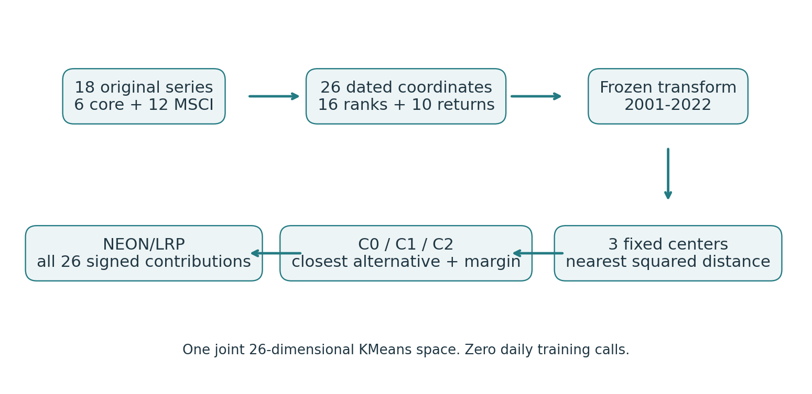

원본 모델 SHA256: 35c632a96524202099c1b5b0d9ad69a37e467eb8145f1a5eb967a98d9584a98b

**채택한 기준**: 2026년 11월 10일 사용자 결정에 따라 frozen Global26 KMeans와 직접 설명인 NEON/LRP를 v1.0으로 채택했다. B12는 과거 비교 자료로 보존한다. 매일의 판정은 기존 nearest-center 규칙을 따른다.

**하루를 읽는 방법**: 필수 입력이 모두 있는 미국 거래일마다 26개 좌표로 된 점 하나를 만든다. 세 중심점 중 가장 가까운 곳의 번호가 C0, C1, C2다. NEON은 같은 거리 비교를 다시 표현해 판단 여유를 설명한다.

**고정한 범위**: Training은 2001-2022년의 완전한 5,391일이다. Scaler, 가중치, 중심점, beta를 고정했다. 데일리 서비스는 새 입력만 계산하며 재학습하지 않는다.

**해석의 목적**: 현재의 주식시장 방향, 동조화, leadership을 함께 기술한다. 이미 검토한 2023-2024년과 2026년 결과는 개발 근거로 보존한다.

## 입력과 거리 계산

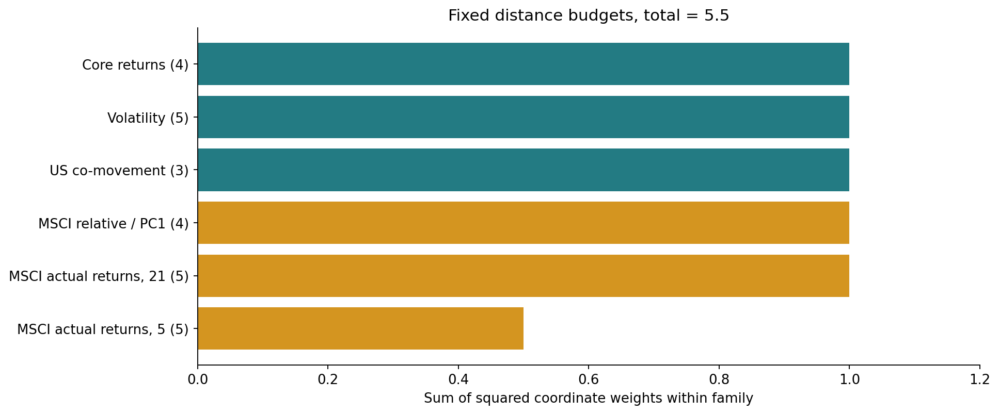

정확한 operator, 지수 코드, 가중치는 model.json과 뒤의 feature inventory에 수록했다.

**원자료**: FMP의 S&P 500, Nasdaq 100, FTSE 100, Yahoo의 원 Russell 2000, Cboe VIX, STOXX V2TX를 쓴다. 추가 입력은 MSCI USD STRD 가격지수 12개에서 계산한다.

**변환**: 처음 16개는 당일을 포함한 최근 252개 관측의 순위다. 마지막 10개는 실제 5일, 21일 수익률을 보존한다. 26개 모두 training 평균과 표준편차로 standardization한 뒤 고정 가중치를 곱한다.

**막대 읽기**: 계열별 budget은 좌표 가중치 제곱의 합이다. 동일한 표준화 변화라면 budget이 클수록 거리에 더 크게 작용한다. 전체 26차원을 한꺼번에 clustering하며 거리의 가중치는 연구자가 정했다.

**거래일**: FTSE는 영국 거래일, VSTOXX는 발표 관측일로 먼저 계산한다. MSCI는 미국 거래일에 맞춘 뒤 수익률을 계산한다. 필수 입력이 없으면 해당 날짜는 산출하지 않는다.

## Equity feature: Training과 validation

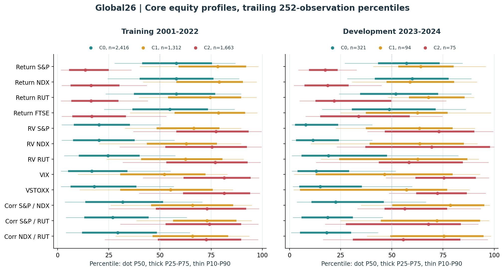

각 패널은 같은 feature 순서와 눈금이다. n은 해당 state의 날짜 수이며 통계적 독립 표본 수와는 다르다.

**그림을 만든 순서**: 하루마다 12개 feature와 state를 계산한다. 같은 state의 날짜들을 모아 feature별 순위를 요약했다. 왼쪽은 training, 오른쪽은 2023-2024년이다. 후자는 개선 과정에서 여러 번 확인한 development 기간이다.

**점과 선을 읽는 법**: 가로 0-100은 최근 252개 관측값 안의 percentile이다. 점은 가운데 값 P50, 굵은 선은 가운데 절반 P25-P75, 가는 선은 가운데 80% P10-P90다. 색 선이 겹칠수록 feature 하나로 구분하기 어렵다.

**실제로 보이는 구분**: S&P return의 C0/C1/C2 median은 training 57.9/78.2/13.5, development 57.1/64.1/17.5다. C2의 낮은 return과 C1의 높은 return 구분은 반복된다.

**C0와 C1의 차이**: Development의 S&P/Russell correlation median은 18.7/72.0/67.9다. C0/C1 return은 겹치지만 낮은 co-movement가 C0를 구분한다. 낮은 percentile도 실제 수익률이 양수일 수 있다.

## 추가 feature 1: 상대 강도와 국가 구조

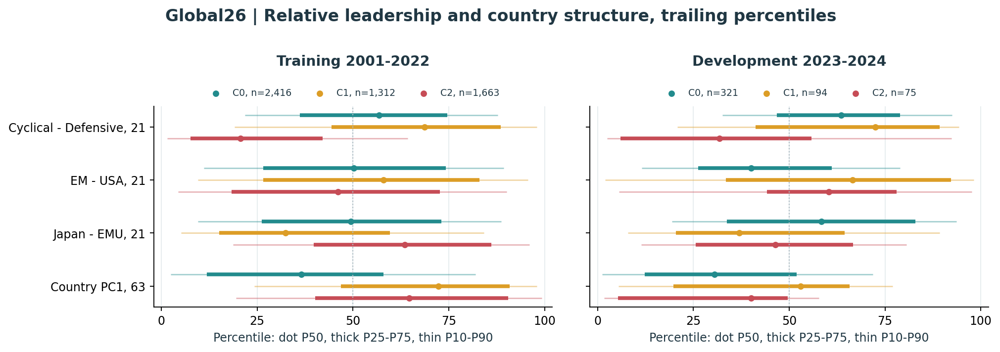

국가: USA, UK, Japan, Canada, Australia, Germany, France, Switzerland. 원계열은 MSCI USD STRD price index다.

**추가한 네 숫자**: Cyclical-Defensive, EM-USA, Japan-EMU의 21일 수익률 차이와 국가 PC1 share 63일이다. 수익률 차이가 양수면 앞쪽 시장이 더 강했다. PC1 share가 높으면 국가별 움직임에서 공통 움직임의 몫이 크다.

**같은 percentile로 표시**: 모두 최근 252개 관측 안의 rank다. Country PC1은 8개국 일별 USD 수익률의 최근 63일 correlation matrix에서 가장 큰 고윳값을 전체 고윳값 합으로 나눈 뒤 rank로 바꾼다.

**작동하는 구분**: Cyclical-Defensive median은 training 56.7/68.7/20.6, development 63.5/72.4/31.7이다. C2에서 상대적으로 낮고 C1에서 높아, 기존 주가지수와 다른 업종 주도 정보를 보탠다.

**해석의 일관성**: Country PC1 rank는 C0가 C1보다 낮다. 하지만 raw PC1의 development median은 C0 0.608, C1 0.579다. Rank의 비교 구간이 날짜마다 달라 생기는 차이다. EM-USA와 Japan-EMU는 세 state를 일관된 한 줄 순서로 나누지 못한다.

## 추가 feature 2: 실제 수익률

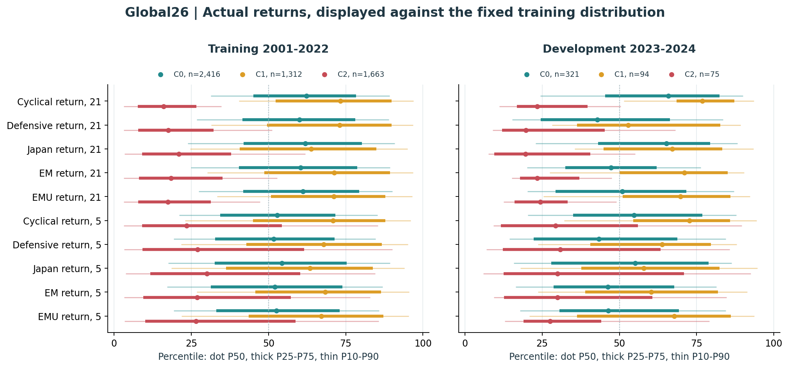

실제 수익률은 P(t)/P(t-h)-1이다. 전체 h+1개 가격이 있는 창만 사용한다. 임의 결측 보충은 하지 않는다.

**왜 실제 수익률도 넣었나**: Rank만 보면 -2%도 최근보다 좋으면 높은 값이 된다. Cyclical, Defensive, Japan, EM, EMU의 5일과 21일 수익률 10개를 추가해 실제 상승과 하락의 크기를 모델에 전달했다.

**그림의 percentile은 별도다**: 모델에는 실제 수익률을 standardization해서 넣는다. 보기 쉽게 그림에서만 2001-2022년 수익률 분포에 대입해 0-100 위치로 바꿨다. 이 페이지의 80은 고정된 training 분포에서 높은 값이라는 뜻이다.

**C1과 C2의 방향 구분**: Development에서 Cyclical 21일 수익률 median은 C0 +2.7%, C1 +3.7%, C2 -2.5%다. EM은 +0.6%, +4.0%, -3.2%다. 이 입력들이 회복과 광범위한 약세를 구분하는 데 정보를 보탠다.

**C0와 C1은 여전히 겹친다**: Japan 21일 median은 C0 +2.1%, C1 +2.4%로 가깝다. 특정 지역의 강세만으로 동반 상승을 확정하기 어렵다. 5일과 21일은 원지수가 같아 correlation을 함께 확인해야 한다.

## Feature 간 correlation

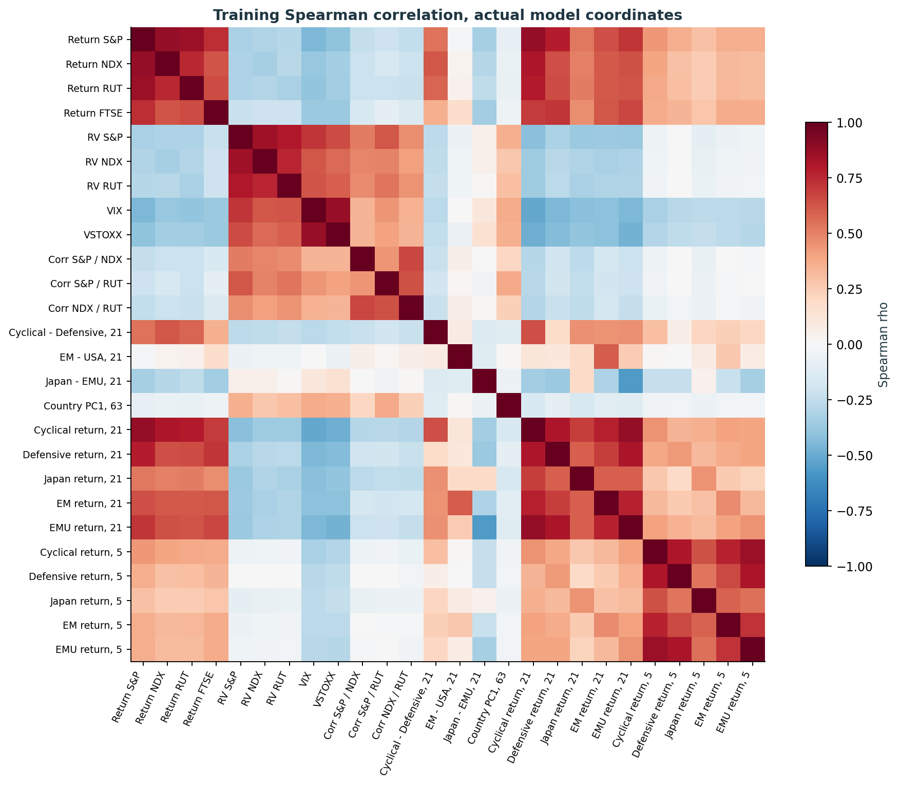

상관 검사는 training 5,391일 기준이다. Development와 2026년 행렬, 각 feature의 가장 가까운 상대는 별도 표에 저장했다.

**읽는 방법**: 가로와 세로가 같은 feature 목록이다. 두 feature가 만나는 칸의 Spearman correlation을 그렸다. 진한 빨강은 같은 방향, 파랑은 반대 방향, 흰색은 순위 관계가 약한 경우다. 대각선은 자기 자신이므로 항상 1이다.

**확인된 중복**: Training에서 S&P return rank와 Cyclical 21일 실제 수익률은 0.879, Cyclical과 EMU 21일 수익률은 0.876이다. 서로 다른 이름의 입력이 같은 움직임을 반복해서 담을 수 있다.

**현재 가중치의 의미**: 기존 return, volatility, co-movement는 각각 제곱거리 예산 1이다. 추가 상대/구조 1, 실제 21일 수익률 1, 실제 5일 수익률 0.5로 총 5.5다. 이 비중은 연구자가 고정한 선택이다.

**현재 판단**: 높은 correlation의 Cyclical 21일 좌표를 제거했던 비교에서는 설득력 있던 사례 3개를 잃었다. 따라서 유지하되, 중복이 해소됐다고 결론 내리지는 않는다.

## 2026년 가격 위의 regime

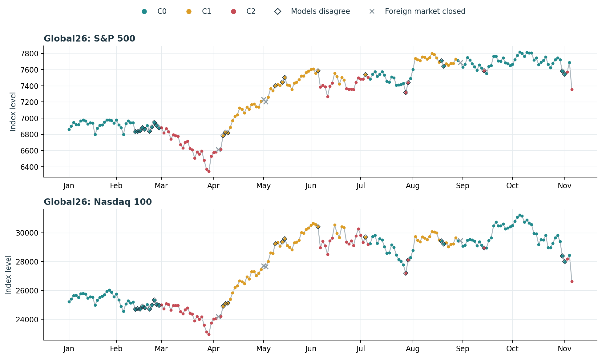

회색 ×는 해외 휴장으로 state 미산출이다. 가격선은 계속 표시한다. 연간 개별 25일 해석은 이전 비교 보고서에 보존했다.

**그래프 읽기**: 위는 S&P 500, 아래는 Nasdaq 100 실제 종가다. 색은 Global26의 state다. 두 가격선에는 같은 시장 regime 날짜를 표시했다. 검은 마름모는 다른 모델과 판단이 달랐던 날이다.

**모델이 포착한 흐름**: 3월 하락은 대체로 C2, 4월 회복은 일부 C1으로 바뀐다. 2월 미국 약세와 해외 강세가 섞인 날은 C0로 읽어 지역 분화를 보탰다.

**보존할 반례**: 5월 13일은 Nasdaq 21일 +13.64%인데 상승 국가는 2/8개였다. Global26 C1은 상승 범위를 넓게 읽었고, B12 C0가 글로벌 분화를 더 잘 설명했다.

**연간 숫자의 범위**: 공통 209일 중 두 모델 판단이 다른 날은 25일, 12.0%다. 변화의 장단점은 당시 자료로 평가했다. 다음날 수익률과 전환 횟수는 이번 모델 선택 기준에 넣지 않았다.

## Global26 선택 근거와 약점

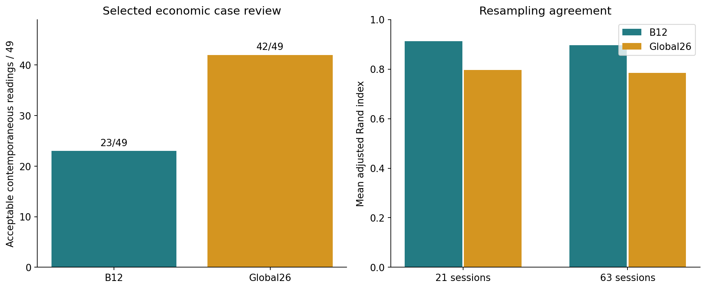

시장 해석의 부합도와 재표집 안정성은 서로 다른 속성이다. 이미 검토한 표본은 노출된 개발 자료로 관리한다.

**시장 설명력**: 기존 판단이 달랐던 49일을 사전 작성한 허용 가능한 시장 해석과 대조했다. Global26은 42/49, B12는 23/49일이 부합했다. 모델 선택에 활용한 사례이며 Global26의 미해결 사례 7일도 보존한다.

**안정성의 비용**: 21일, 63일 블록 재표집 ARI는 Global26 0.797/0.784, B12 0.912/0.897이다. 각 블록 길이에서 네 training cutoff에 걸쳐 120회 fit했다. Global26은 표본 변화에 더 민감했다.

**구체적인 반례**: 2026년 5월 13일 Nasdaq의 21일 수익률은 +13.64%였지만 상승한 국가 지수는 2/8개였다. Global26 C1은 세계적 상승 참여를 과장하며, 이 사례에서는 B12 C0의 분화 해석이 더 설득력 있었다.

**이름을 읽는 기준**: C0는 차별화와 낮은 동조화, C1은 동반 상승, C2는 약세와 스트레스다. 실제 수익률, 상승 참여, 반대 기여를 함께 읽는다. Feature 선정 기준에서 전환 횟수는 제외했다.

## NEON이 기존 판단을 설명하는 방법

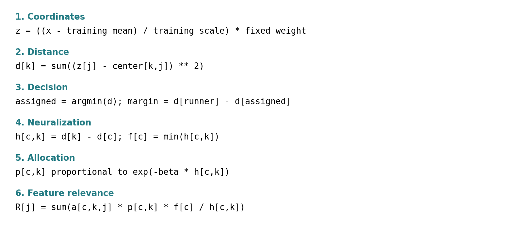

Kauffmann et al., NEON, arXiv:1906.07633v2, section II. 정확한 판정 동률이면 선택 국면 LRP 미정으로 표시한다.

**같은 판정 규칙**: 제곱거리의 차이는 변환된 좌표에 대해 선형이다. 선형 비교와 최솟값 선택으로 기존 nearest-center 판정을 그대로 재현한다. 데일리 판정에서 XGBoost 대리모델은 사용하지 않는다.

**선택된 국면 하나를 설명**: 선택된 c와 나머지 두 중심점 k를 비교한다. 가장 작은 우위가 판단 여유 f[c]다. Directional LRP는 이 여유를 두 비교에 배분한 다음 26개 좌표로 나눈다.

**부호의 의미**: 각 좌표가 경쟁 중심점의 중간점보다 어느 쪽에 있는지와 중심점 차이를 곱해 기여를 계산한다. 양수는 선택 국면을 지지하고 음수는 상쇄한다. 부호를 살린 합계가 최종 판단 여유다.

**설명 설정과 활용**: Beta는 training 평균 판단 여유의 역수인 0.2660534496이다. Beta를 바꾸면 기여도는 달라져도 판정은 유지된다. 서로 겹치는 feature는 함께 해석하며 경제적 유용성은 사례와 통제된 제거 실험으로 평가한다.

## 최신 완전 관측: 2026-11-06

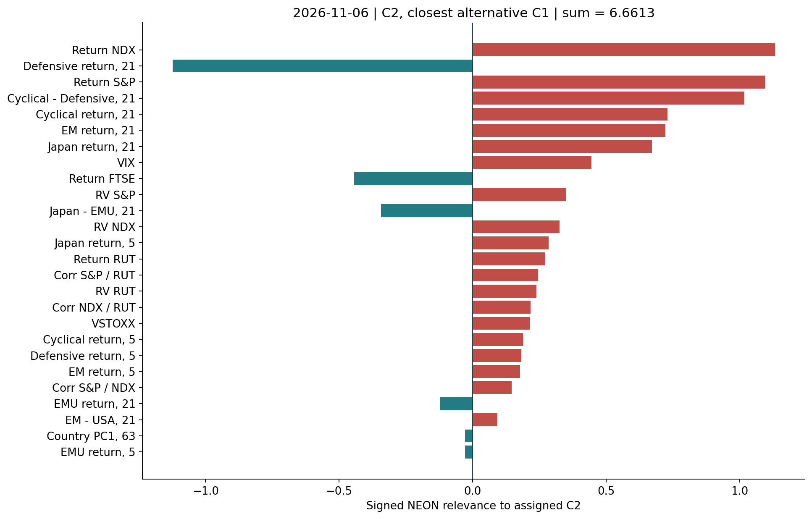

26개 기여도를 모두 표시했다. 막대 부호는 C2 지지 방향이며 시장 수익률 부호와 구별한다.

**판정과 거리**: C2가 가장 가깝다. 제곱거리는 C0 14.926, C1 12.411, C2 5.750다. 판단 여유 6.6613, 거리 합으로 나눈 여유 0.367다.

**C2 지지 근거**: Nasdaq return rank +1.132, S&P return rank +1.095, Cyclical-Defensive rank +1.018이 크게 작용했다. 실제 21일 수익률도 Nasdaq -12.16%, S&P -5.00%, Cyclical -6.57%, EM -11.55%다.

**반대 근거**: Defensive21은 +6.55% 상승했고 C2에 -1.124 기여했다. FTSE21도 +2.23%이며 기여는 -0.444다. 현재 C2 안에는 방어주 강세와 지역 차별화가 함께 존재한다.

**데이터 기준일**: 11월 10일 수집에서 17개 원자료는 11월 9일을 포함하지만 공식 Cboe VIX 일별 파일은 11월 6일까지다. 11월 9일 판정은 보류하고 API는 기존 11월 6일 결과와 missing_inputs를 함께 반환한다.

## Percentile과 판단 여유 읽기

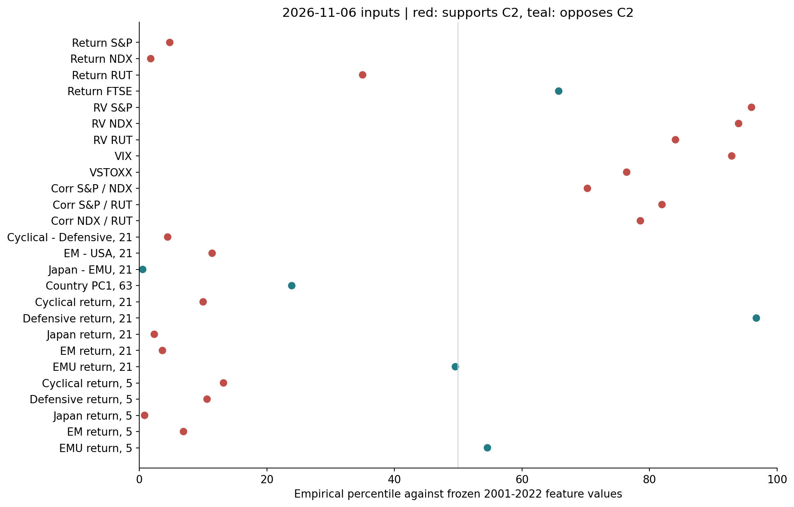

동일 국면 기준 표본은 training C2 1,663일이다. Percentile과 설명 배분 가중치는 기술 통계다.

**가로축 계산**: 현재 model input보다 작은 training 값의 비중을 세고 동률에는 절반을 배분한다. 분모는 5,391일이다. 이 그림은 모든 좌표에 고정 training 기준을 쓰며, 순위형 feature 자체의 이동 기준과 구별한다.

**관측된 조합**: Nasdaq return은 training percentile 1.8, S&P 4.8, Cyclical-Defensive 4.5, Defensive21 96.8이다. 주식 약세 속에서 방어주 상대 강세가 두드러진 조합이다.

**판정 여유와 유사도**: C2 판단 여유는 training C2일의 61.0 percentile, 중심점과의 거리는 85.6 percentile이다. 경계 표시와 기존 atypical 표시는 모두 꺼져 있고 26개 입력이 training 범위 안에 있다.

**각각 다른 질문**: Feature percentile은 입력 수준, margin percentile은 가장 가까운 대안과의 차이, distance percentile은 선택 중심점과의 유사성을 말한다. 각 분모를 확인하며 함께 읽는다.

## Global26: 추가 feature가 하는 일

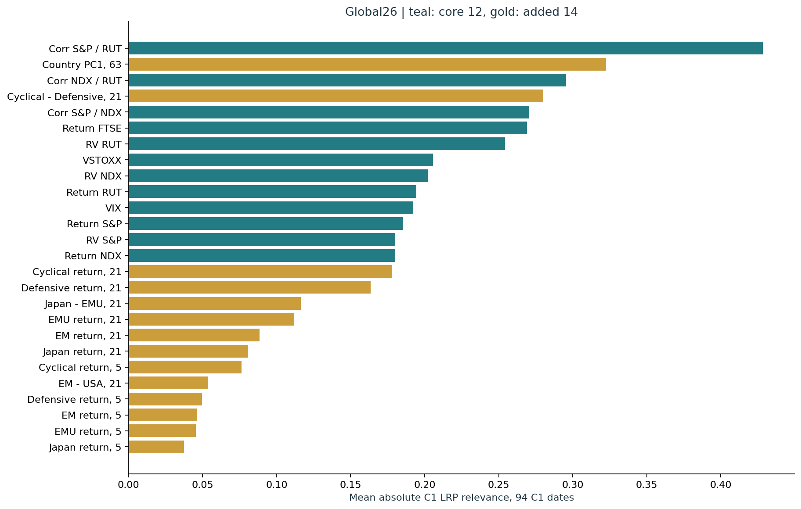

절댓값이 크다는 것과 C1을 지지한다는 것은 구분해서 읽는다. 두 모델은 중심점과 점수 단위가 다르다.

**그리는 방법**: Global26이 C1으로 판단한 validation 94일에서 기여도 절댓값을 평균냈다. 금색은 추가된 14개 좌표다. B12의 C1 77일과 표본 구성이 다르다.

**결과**: Country PC1은 2위 0.323, Cyclical - Defensive 수익률은 4위 0.280이다. 부호를 살린 평균은 각각 -0.078, +0.096이다. Country PC1은 크기가 큰 만큼 C1에 반대하는 역할도 자주 한다.

**해석**: 국가 동조화와 업종 leadership이 판단 균형에 들어온다. Country PC1의 부호 평균은 training +0.170에서 validation -0.078로 바뀐다. 후반 표본의 C1에는 세계 동조화가 약한 날도 포함됐다. 5일 절대수익률의 좌표별 역할은 상대적으로 작다.

## v1.0 이전 검증

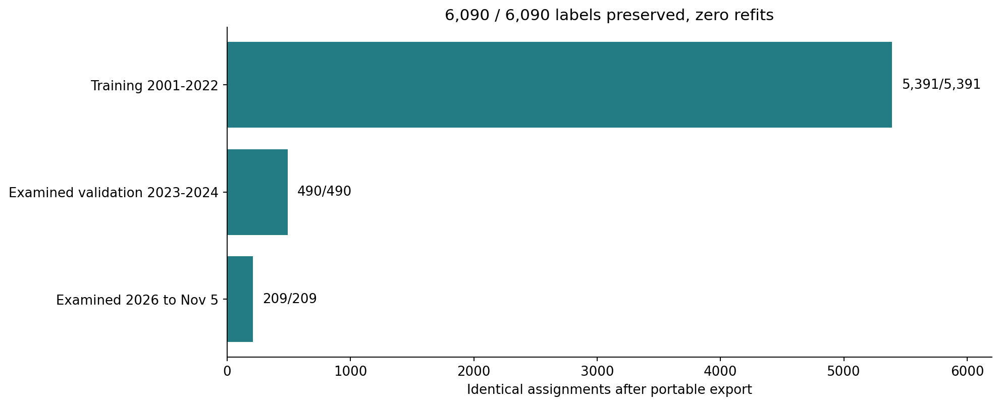

수치 동등성 허용 오차는 절대와 상대 각각 1e-9다. 상세 JSON, XML 검증 자료를 릴리스에 포함한다.

**판정과 설명 유지**: 기존 Global26의 6,090일 판정이 전부 일치했다. 거리 최대 오차는 7.11e-15, 기여도는 4.44e-16, 기여도 합계는 2.13e-14였다.

**원자료부터 재구성**: 저장된 원자료로 26개 feature를 독립 재계산했다. 과거 6,037개 행과 2026년 209개 행의 누락 패턴 및 완전한 날짜의 판정이 일치했다. Feature 최대 오차는 4.31e-16이다.

**서비스 동작**: 자동 검사 18개로 인증, 기존 결과 보존, 2025 warmup 보호, 거래일 마감 시각, 입력 누락, 모델 손상, 경로 안전성, 중복 작업 방지, 모델 교체와 복구를 확인했다.

**사용 자원**: 최대 RSS는 판정 재현 173.5MiB, feature 재구성 132.0MiB, 서비스 검사 114.1MiB다. 수치 계산은 한 thread이며 데일리 컨테이너는 1GiB, API는 512MiB로 제한한다.

## 데일리 API와 모델 교체

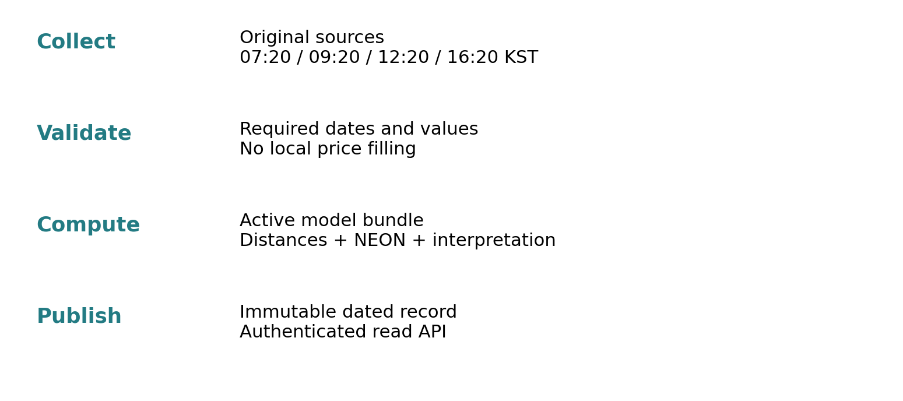

지원하는 operator 범위에서는 bundle만 교체한다. 새 operator는 엔진 갱신이 필요하다. 서버 API와 타이머가 실행 중이며 원자료 수집과 인증 응답을 확인했다. 최신 운영 상태는 docs/DEPLOYMENT.md를 참고한다.

**매일 실행**: 사내 서버의 수집 일정은 월요일부터 토요일까지 한국 시각 07:20, 09:20, 12:20, 16:20으로 설정했다. 미국 예정 마감 후 90분이 지난 거래일까지 계산하며 후속 실행은 지연 공급을 재확인한다.

**API가 주는 내용**: 모델 버전과 hash, 미국 기준일, 원자료 snapshot, C0/C1/C2, 가까운 대안, 세 거리, percentile, NEON 26개 기여도, 정해진 근거로 만든 한국어와 영어 해석을 제공한다.

**누락과 개정**: 입력이 불완전한 날짜는 보류한다. 마지막 유효 결과에 원자료별 누락과 지연 상태를 함께 표시한다. 이미 발표한 버전별 날짜 결과는 유지하고 이후 원자료 개정은 별도로 기록한다.

**모델만 교체**: 새 bundle 검증, 기존 모델 기준일까지 새 버전 계산, active pointer 교체 순으로 진행한다. API는 재시작 없이 새 pointer를 읽는다. 이전 bundle과 날짜별 결과를 보존하므로 복구할 수 있다.

## 버전 기준과 다음 연구

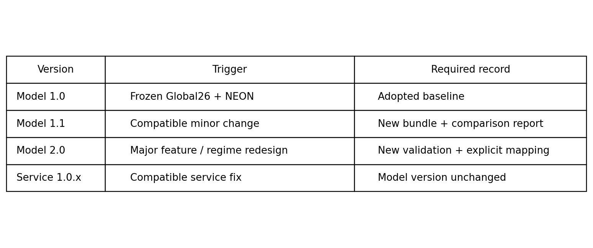

자동 재학습과 자동 승격을 두지 않고 채택한 bundle의 재현성을 유지한다.

**큰 변경**: 주요 feature 추가와 제거, 원지수 정체성, regime 의미, clustering 거리 구조가 크게 바뀌면 v2.0이다. 새 비교 보고서와 채택 결정을 마칠 때까지 기존 버전을 운영한다.

**작은 변경**: 호환되는 작은 모델 또는 설명 변경은 v1.1이다. 이 경우도 새 immutable bundle과 재현 검사, 비교 기록이 필요하다. 판정이 바뀌면 달라진 날짜를 릴리스 보고서에 명시한다.

**서비스 버전 분리**: 판정을 유지하는 API 오류 수정이나 운영 변경은 서비스 patch 버전을 올린다. 각 결과에 model version과 service version을 함께 저장한다. API 경로 /v1은 별도의 응답 규약 버전이다.

**다음 연구**: 겹치는 co-movement와 return 계열의 제거 실험, 방향과 상승 참여에 따른 C1 명칭 검토가 우선이다. Macro 데이터 선정과 시간 재가공은 별도 실험이며 연구 중에도 v1.0은 고정한다.

## Global26 / Return S&P

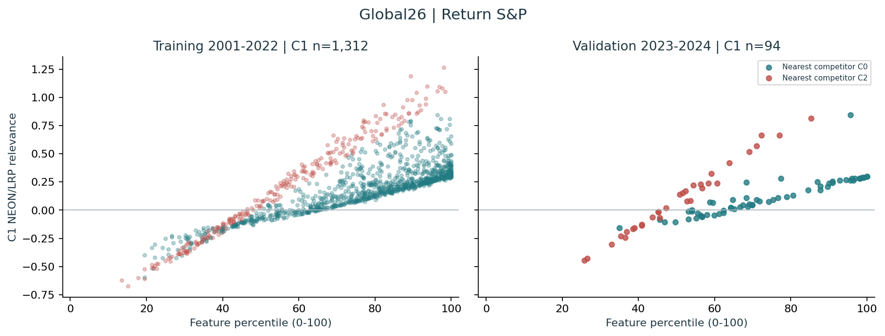

가로축 하위/상위 사분위는 해당 validation C1 표본 안에서 구했다. 다른 feature도 함께 움직인 관측 결과다.

**축과 표본**: 직전 252개 관측 안에서의 순위에 100을 곱한 값이다. 점 하나는 C1 하루다. 왼쪽 1,312일, 오른쪽 94일이며 세로축 범위는 같다. 색은 가장 가까운 경쟁 국면이다.

**관측 결과**: 기여 절댓값 평균은 training 0.270, validation 0.185, validation 26개 중 12위다. 부호 평균 +0.110, C1 지지 일수 비중 67.0%. 낮은/높은 percentile 사분위의 기여 중앙값은 -0.105/+0.266다.

**해석**: 21일 단순수익률을 직전 252개 관측 안에서 순위로 바꾼 값이다. 높은 percentile은 최근 자기 이력보다 강하다는 뜻이며 실제 수익률의 부호는 원자료에서 확인한다. 가장 가까운 입력은 Cyclical return, 21, 이 C1 표본에서 correlation 0.888다.

## Global26 / Return NDX

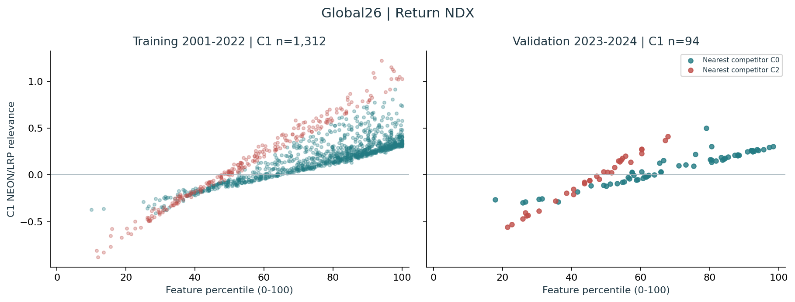

가로축 하위/상위 사분위는 해당 validation C1 표본 안에서 구했다. 다른 feature도 함께 움직인 관측 결과다.

**축과 표본**: 직전 252개 관측 안에서의 순위에 100을 곱한 값이다. 점 하나는 C1 하루다. 왼쪽 1,312일, 오른쪽 94일이며 세로축 범위는 같다. 색은 가장 가까운 경쟁 국면이다.

**관측 결과**: 기여 절댓값 평균은 training 0.265, validation 0.180, validation 26개 중 14위다. 부호 평균 +0.027, C1 지지 일수 비중 56.4%. 낮은/높은 percentile 사분위의 기여 중앙값은 -0.261/+0.233다.

**해석**: 21일 단순수익률을 직전 252개 관측 안에서 순위로 바꾼 값이다. 높은 percentile은 최근 자기 이력보다 강하다는 뜻이며 실제 수익률의 부호는 원자료에서 확인한다. 가장 가까운 입력은 Return S&P, 이 C1 표본에서 correlation 0.884다.

## Global26 / Return RUT

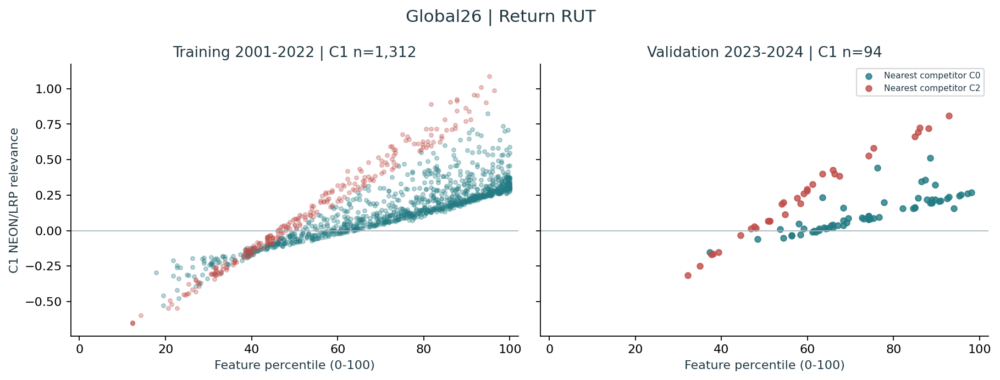

가로축 하위/상위 사분위는 해당 validation C1 표본 안에서 구했다. 다른 feature도 함께 움직인 관측 결과다.

**축과 표본**: 직전 252개 관측 안에서의 순위에 100을 곱한 값이다. 점 하나는 C1 하루다. 왼쪽 1,312일, 오른쪽 94일이며 세로축 범위는 같다. 색은 가장 가까운 경쟁 국면이다.

**관측 결과**: 기여 절댓값 평균은 training 0.227, validation 0.194, validation 26개 중 10위다. 부호 평균 +0.163, C1 지지 일수 비중 84.0%. 낮은/높은 percentile 사분위의 기여 중앙값은 +0.009/+0.242다.

**해석**: 21일 단순수익률을 직전 252개 관측 안에서 순위로 바꾼 값이다. 높은 percentile은 최근 자기 이력보다 강하다는 뜻이며 실제 수익률의 부호는 원자료에서 확인한다. 가장 가까운 입력은 Return S&P, 이 C1 표본에서 correlation 0.544다.

## Global26 / Return FTSE

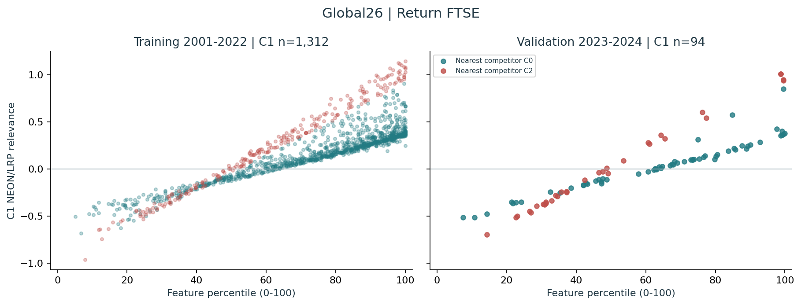

가로축 하위/상위 사분위는 해당 validation C1 표본 안에서 구했다. 다른 feature도 함께 움직인 관측 결과다.

**축과 표본**: 직전 252개 관측 안에서의 순위에 100을 곱한 값이다. 점 하나는 C1 하루다. 왼쪽 1,312일, 오른쪽 94일이며 세로축 범위는 같다. 색은 가장 가까운 경쟁 국면이다.

**관측 결과**: 기여 절댓값 평균은 training 0.295, validation 0.269, validation 26개 중 6위다. 부호 평균 +0.026, C1 지지 일수 비중 52.1%. 낮은/높은 percentile 사분위의 기여 중앙값은 -0.363/+0.358다.

**해석**: 21일 단순수익률을 직전 252개 관측 안에서 순위로 바꾼 값이다. 높은 percentile은 최근 자기 이력보다 강하다는 뜻이며 실제 수익률의 부호는 원자료에서 확인한다. 가장 가까운 입력은 Defensive return, 21, 이 C1 표본에서 correlation 0.579다.

## Global26 / RV S&P

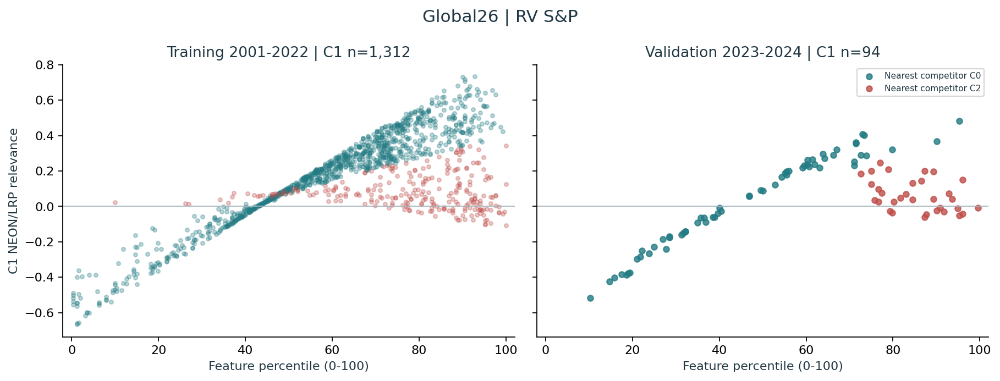

가로축 하위/상위 사분위는 해당 validation C1 표본 안에서 구했다. 다른 feature도 함께 움직인 관측 결과다.

**축과 표본**: 직전 252개 관측 안에서의 순위에 100을 곱한 값이다. 점 하나는 C1 하루다. 왼쪽 1,312일, 오른쪽 94일이며 세로축 범위는 같다. 색은 가장 가까운 경쟁 국면이다.

**관측 결과**: 기여 절댓값 평균은 training 0.239, validation 0.180, validation 26개 중 13위다. 부호 평균 +0.044, C1 지지 일수 비중 57.4%. 낮은/높은 percentile 사분위의 기여 중앙값은 -0.235/+0.040다.

**해석**: 21일 realized volatility다. 낮은 변동성은 차분한 C0에 가까울 수 있고, 스트레스 C2와 비교할 때는 기여 방향이 달라질 수 있다. 경쟁 국면 색을 함께 읽는다. 가장 가까운 입력은 RV NDX, 이 C1 표본에서 correlation 0.956다.

## Global26 / RV NDX

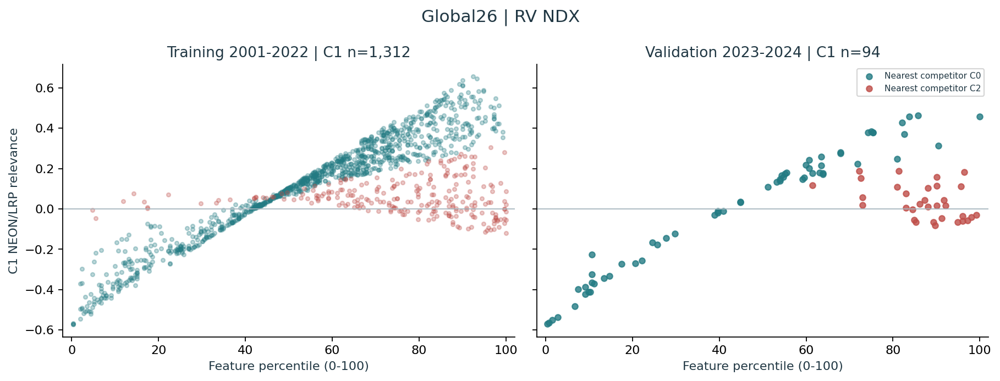

가로축 하위/상위 사분위는 해당 validation C1 표본 안에서 구했다. 다른 feature도 함께 움직인 관측 결과다.

**축과 표본**: 직전 252개 관측 안에서의 순위에 100을 곱한 값이다. 점 하나는 C1 하루다. 왼쪽 1,312일, 오른쪽 94일이며 세로축 범위는 같다. 색은 가장 가까운 경쟁 국면이다.

**관측 결과**: 기여 절댓값 평균은 training 0.210, validation 0.202, validation 26개 중 9위다. 부호 평균 +0.015, C1 지지 일수 비중 58.5%. 낮은/높은 percentile 사분위의 기여 중앙값은 -0.354/+0.017다.

**해석**: 21일 realized volatility다. 낮은 변동성은 차분한 C0에 가까울 수 있고, 스트레스 C2와 비교할 때는 기여 방향이 달라질 수 있다. 경쟁 국면 색을 함께 읽는다. 가장 가까운 입력은 RV S&P, 이 C1 표본에서 correlation 0.956다.

## Global26 / RV RUT

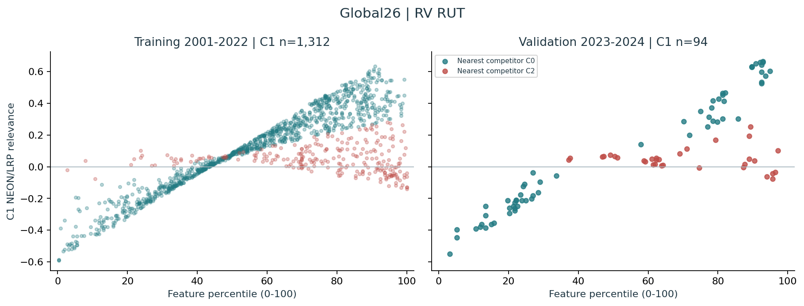

가로축 하위/상위 사분위는 해당 validation C1 표본 안에서 구했다. 다른 feature도 함께 움직인 관측 결과다.

**축과 표본**: 직전 252개 관측 안에서의 순위에 100을 곱한 값이다. 점 하나는 C1 하루다. 왼쪽 1,312일, 오른쪽 94일이며 세로축 범위는 같다. 색은 가장 가까운 경쟁 국면이다.

**관측 결과**: 기여 절댓값 평균은 training 0.205, validation 0.254, validation 26개 중 7위다. 부호 평균 +0.075, C1 지지 일수 비중 59.6%. 낮은/높은 percentile 사분위의 기여 중앙값은 -0.270/+0.528다.

**해석**: 21일 realized volatility다. 낮은 변동성은 차분한 C0에 가까울 수 있고, 스트레스 C2와 비교할 때는 기여 방향이 달라질 수 있다. 경쟁 국면 색을 함께 읽는다. 가장 가까운 입력은 EM - USA, 21, 이 C1 표본에서 correlation -0.569다.

## Global26 / VIX

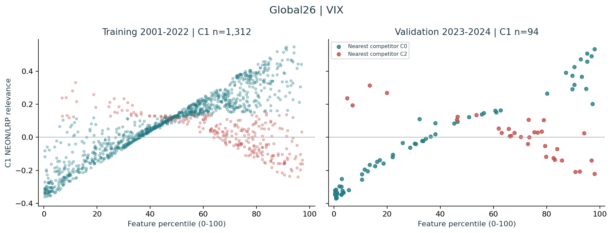

가로축 하위/상위 사분위는 해당 validation C1 표본 안에서 구했다. 다른 feature도 함께 움직인 관측 결과다.

**축과 표본**: 직전 252개 관측 안에서의 순위에 100을 곱한 값이다. 점 하나는 C1 하루다. 왼쪽 1,312일, 오른쪽 94일이며 세로축 범위는 같다. 색은 가장 가까운 경쟁 국면이다.

**관측 결과**: 기여 절댓값 평균은 training 0.158, validation 0.192, validation 26개 중 11위다. 부호 평균 -0.010, C1 지지 일수 비중 50.0%. 낮은/높은 percentile 사분위의 기여 중앙값은 -0.322/+0.278다.

**해석**: 내재변동성 수준의 순위다. 차분한 C0, 활동적인 C1, 스트레스 C2를 구분하는 역할이 있어 경쟁 국면에 따라 기여가 달라진다. 가장 가까운 입력은 VSTOXX, 이 C1 표본에서 correlation 0.909다.

## Global26 / VSTOXX

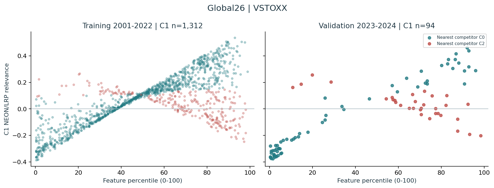

가로축 하위/상위 사분위는 해당 validation C1 표본 안에서 구했다. 다른 feature도 함께 움직인 관측 결과다.

**축과 표본**: 직전 252개 관측 안에서의 순위에 100을 곱한 값이다. 점 하나는 C1 하루다. 왼쪽 1,312일, 오른쪽 94일이며 세로축 범위는 같다. 색은 가장 가까운 경쟁 국면이다.

**관측 결과**: 기여 절댓값 평균은 training 0.163, validation 0.206, validation 26개 중 8위다. 부호 평균 -0.035, C1 지지 일수 비중 48.9%. 낮은/높은 percentile 사분위의 기여 중앙값은 -0.332/+0.238다.

**해석**: 내재변동성 수준의 순위다. 차분한 C0, 활동적인 C1, 스트레스 C2를 구분하는 역할이 있어 경쟁 국면에 따라 기여가 달라진다. 가장 가까운 입력은 VIX, 이 C1 표본에서 correlation 0.909다.

## Global26 / Corr S&P / NDX

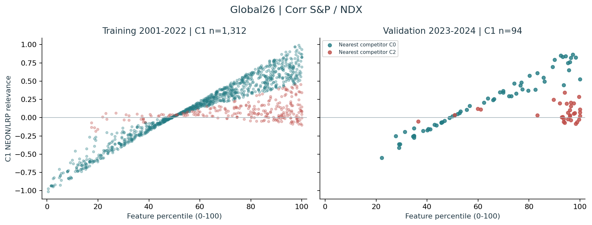

가로축 하위/상위 사분위는 해당 validation C1 표본 안에서 구했다. 다른 feature도 함께 움직인 관측 결과다.

**축과 표본**: 직전 252개 관측 안에서의 순위에 100을 곱한 값이다. 점 하나는 C1 하루다. 왼쪽 1,312일, 오른쪽 94일이며 세로축 범위는 같다. 색은 가장 가까운 경쟁 국면이다.

**관측 결과**: 기여 절댓값 평균은 training 0.317, validation 0.270, validation 26개 중 5위다. 부호 평균 +0.168, C1 지지 일수 비중 67.0%. 낮은/높은 percentile 사분위의 기여 중앙값은 -0.164/+0.102다.

**해석**: 21일 동안 일별 수익률이 얼마나 함께 움직였는지 측정한다. 같은 correlation 수준도 경쟁 국면에 따라 C1 기여가 달라진다. 가장 가까운 입력은 RV NDX, 이 C1 표본에서 correlation 0.738다.

## Global26 / Corr S&P / RUT

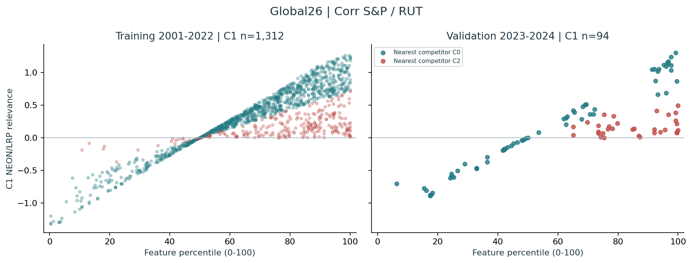

가로축 하위/상위 사분위는 해당 validation C1 표본 안에서 구했다. 다른 feature도 함께 움직인 관측 결과다.

**축과 표본**: 직전 252개 관측 안에서의 순위에 100을 곱한 값이다. 점 하나는 C1 하루다. 왼쪽 1,312일, 오른쪽 94일이며 세로축 범위는 같다. 색은 가장 가까운 경쟁 국면이다.

**관측 결과**: 기여 절댓값 평균은 training 0.452, validation 0.428, validation 26개 중 1위다. 부호 평균 +0.166, C1 지지 일수 비중 68.1%. 낮은/높은 percentile 사분위의 기여 중앙값은 -0.488/+0.776다.

**해석**: 21일 동안 일별 수익률이 얼마나 함께 움직였는지 측정한다. 같은 correlation 수준도 경쟁 국면에 따라 C1 기여가 달라진다. 가장 가까운 입력은 Corr NDX / RUT, 이 C1 표본에서 correlation 0.952다.

## Global26 / Corr NDX / RUT

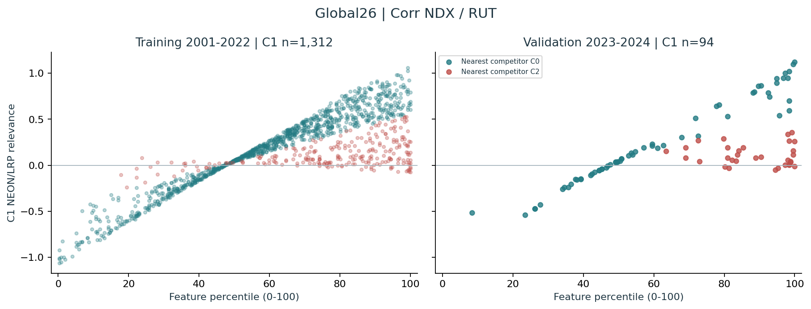

가로축 하위/상위 사분위는 해당 validation C1 표본 안에서 구했다. 다른 feature도 함께 움직인 관측 결과다.

**축과 표본**: 직전 252개 관측 안에서의 순위에 100을 곱한 값이다. 점 하나는 C1 하루다. 왼쪽 1,312일, 오른쪽 94일이며 세로축 범위는 같다. 색은 가장 가까운 경쟁 국면이다.

**관측 결과**: 기여 절댓값 평균은 training 0.335, validation 0.296, validation 26개 중 3위다. 부호 평균 +0.197, C1 지지 일수 비중 71.3%. 낮은/높은 percentile 사분위의 기여 중앙값은 -0.147/+0.338다.

**해석**: 21일 동안 일별 수익률이 얼마나 함께 움직였는지 측정한다. 같은 correlation 수준도 경쟁 국면에 따라 C1 기여가 달라진다. 가장 가까운 입력은 Corr S&P / RUT, 이 C1 표본에서 correlation 0.952다.

## Global26 / Cyclical - Defensive, 21

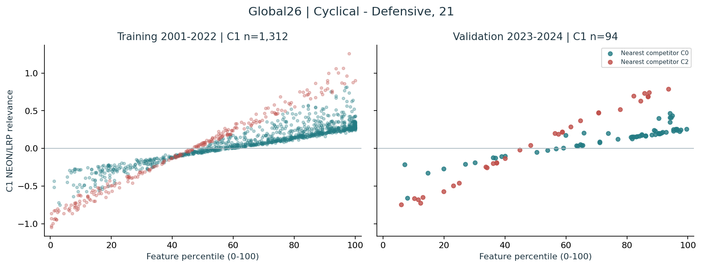

가로축 하위/상위 사분위는 해당 validation C1 표본 안에서 구했다. 다른 feature도 함께 움직인 관측 결과다.

**축과 표본**: 직전 252개 관측 안에서의 순위에 100을 곱한 값이다. 점 하나는 C1 하루다. 왼쪽 1,312일, 오른쪽 94일이며 세로축 범위는 같다. 색은 가장 가까운 경쟁 국면이다.

**관측 결과**: 기여 절댓값 평균은 training 0.250, validation 0.280, validation 26개 중 4위다. 부호 평균 +0.096, C1 지지 일수 비중 70.2%. 낮은/높은 percentile 사분위의 기여 중앙값은 -0.249/+0.240다.

**해석**: 21일 Cyclical 수익률에서 Defensive 수익률을 뺀 값의 순위다. 시장 전체 방향과 구별되는 업종 leadership을 나타낸다. 가장 가까운 입력은 Corr S&P / NDX, 이 C1 표본에서 correlation -0.727다.

## Global26 / EM - USA, 21

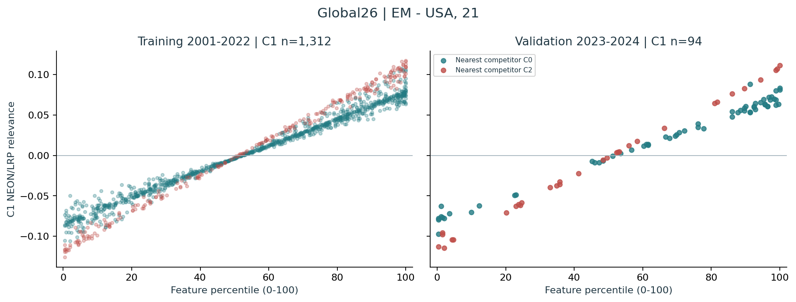

가로축 하위/상위 사분위는 해당 validation C1 표본 안에서 구했다. 다른 feature도 함께 움직인 관측 결과다.

**축과 표본**: 직전 252개 관측 안에서의 순위에 100을 곱한 값이다. 점 하나는 C1 하루다. 왼쪽 1,312일, 오른쪽 94일이며 세로축 범위는 같다. 색은 가장 가까운 경쟁 국면이다.

**관측 결과**: 기여 절댓값 평균은 training 0.048, validation 0.054, validation 26개 중 22위다. 부호 평균 +0.011, C1 지지 일수 비중 62.8%. 낮은/높은 percentile 사분위의 기여 중앙값은 -0.074/+0.069다.

**해석**: EM의 21일 수익률에서 USA를 뺀 값의 순위다. 지역 간 상대 leadership을 더하며 기여 크기는 동조화 feature보다 작다. 가장 가까운 입력은 EM return, 21, 이 C1 표본에서 correlation 0.773다.

## Global26 / Japan - EMU, 21

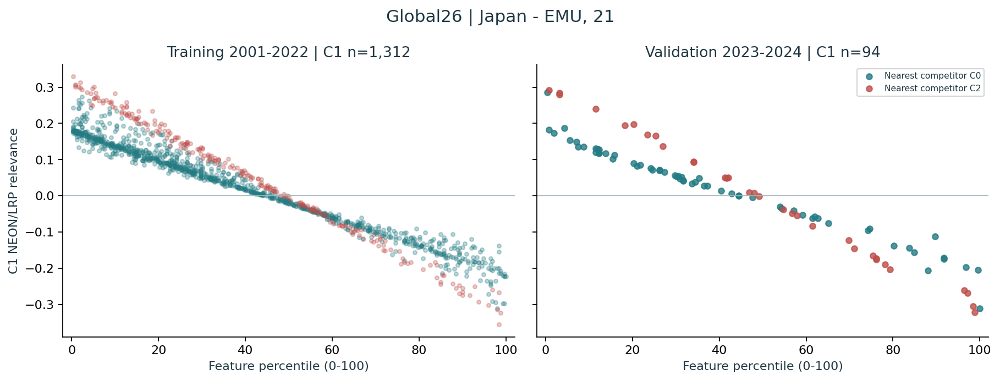

가로축 하위/상위 사분위는 해당 validation C1 표본 안에서 구했다. 다른 feature도 함께 움직인 관측 결과다.

**축과 표본**: 직전 252개 관측 안에서의 순위에 100을 곱한 값이다. 점 하나는 C1 하루다. 왼쪽 1,312일, 오른쪽 94일이며 세로축 범위는 같다. 색은 가장 가까운 경쟁 국면이다.

**관측 결과**: 기여 절댓값 평균은 training 0.113, validation 0.116, validation 26개 중 17위다. 부호 평균 +0.011, C1 지지 일수 비중 60.6%. 낮은/높은 percentile 사분위의 기여 중앙값은 +0.142/-0.173다.

**해석**: Japan의 21일 수익률에서 EMU를 뺀 값의 순위다. 관측된 음의 기울기는 이 고정 C1 중심점에서 EMU의 상대 우위가 기여하는 구조를 보여준다. 가장 가까운 입력은 VSTOXX, 이 C1 표본에서 correlation 0.586다.

## Global26 / Country PC1, 63

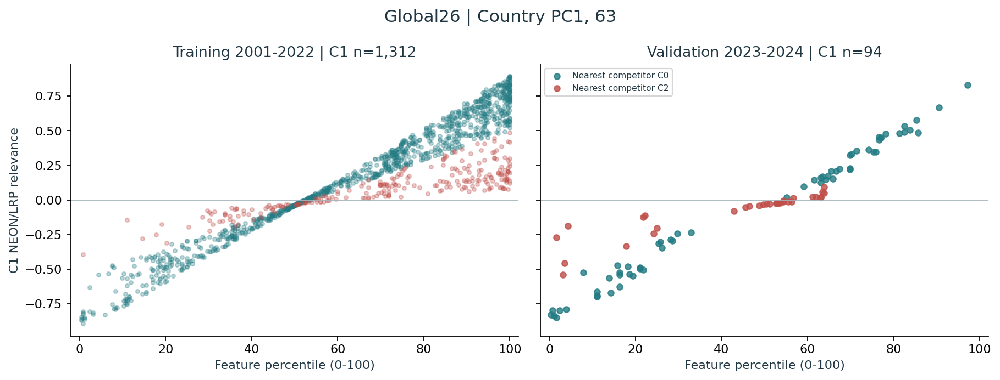

가로축 하위/상위 사분위는 해당 validation C1 표본 안에서 구했다. 다른 feature도 함께 움직인 관측 결과다.

**축과 표본**: 직전 252개 관측 안에서의 순위에 100을 곱한 값이다. 점 하나는 C1 하루다. 왼쪽 1,312일, 오른쪽 94일이며 세로축 범위는 같다. 색은 가장 가까운 경쟁 국면이다.

**관측 결과**: 기여 절댓값 평균은 training 0.349, validation 0.323, validation 26개 중 2위다. 부호 평균 -0.078, C1 지지 일수 비중 43.6%. 낮은/높은 percentile 사분위의 기여 중앙값은 -0.555/+0.441다.

**해석**: Country PC1은 63개 미국 거래일 동안 국가별 수익률 변동을 하나의 축이 설명하는 비중이다. 국가별 loading의 부호가 반대일 수도 있어, 높을수록 공통 축이 강하다고 읽고 실제 상승 방향은 수익률로 확인한다. 가장 가까운 입력은 EM return, 21, 이 C1 표본에서 correlation 0.425다.

## Global26 / Cyclical return, 21

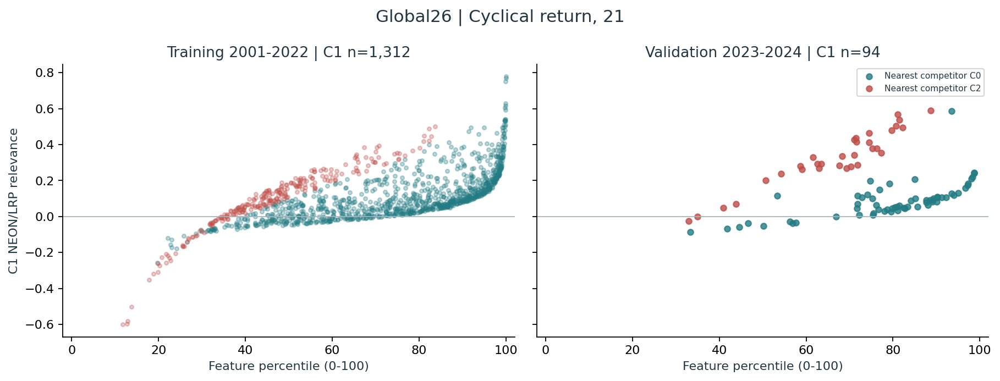

가로축 하위/상위 사분위는 해당 validation C1 표본 안에서 구했다. 다른 feature도 함께 움직인 관측 결과다.

**축과 표본**: Training 5,391개 값과 비교한 표시용 percentile이다. 모델에는 실제 수익률이 입력된다. 점 하나는 C1 하루다. 왼쪽 1,312일, 오른쪽 94일이며 세로축 범위는 같다. 색은 가장 가까운 경쟁 국면이다.

**관측 결과**: 기여 절댓값 평균은 training 0.133, validation 0.178, validation 26개 중 15위다. 부호 평균 +0.169, C1 지지 일수 비중 90.4%. 낮은/높은 percentile 사분위의 기여 중앙값은 +0.059/+0.114다.

**해석**: 실제 21일 단순수익률이 모델에 입력된다. 가로축 percentile은 training 값과 비교한 표시용 변환으로, 관측 수익률의 순서를 보존한다. 가장 가까운 입력은 Return S&P, 이 C1 표본에서 correlation 0.888다.

## Global26 / Defensive return, 21

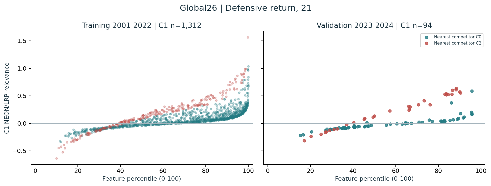

가로축 하위/상위 사분위는 해당 validation C1 표본 안에서 구했다. 다른 feature도 함께 움직인 관측 결과다.

**축과 표본**: Training 5,391개 값과 비교한 표시용 percentile이다. 모델에는 실제 수익률이 입력된다. 점 하나는 C1 하루다. 왼쪽 1,312일, 오른쪽 94일이며 세로축 범위는 같다. 색은 가장 가까운 경쟁 국면이다.

**관측 결과**: 기여 절댓값 평균은 training 0.158, validation 0.164, validation 26개 중 16위다. 부호 평균 +0.072, C1 지지 일수 비중 51.1%. 낮은/높은 percentile 사분위의 기여 중앙값은 -0.108/+0.288다.

**해석**: 실제 21일 단순수익률이 모델에 입력된다. 가로축 percentile은 training 값과 비교한 표시용 변환으로, 관측 수익률의 순서를 보존한다. 가장 가까운 입력은 Cyclical - Defensive, 21, 이 C1 표본에서 correlation -0.638다.

## Global26 / Japan return, 21

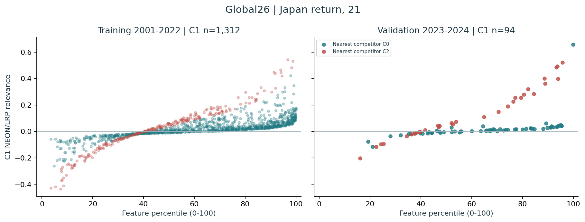

가로축 하위/상위 사분위는 해당 validation C1 표본 안에서 구했다. 다른 feature도 함께 움직인 관측 결과다.

**축과 표본**: Training 5,391개 값과 비교한 표시용 percentile이다. 모델에는 실제 수익률이 입력된다. 점 하나는 C1 하루다. 왼쪽 1,312일, 오른쪽 94일이며 세로축 범위는 같다. 색은 가장 가까운 경쟁 국면이다.

**관측 결과**: 기여 절댓값 평균은 training 0.064, validation 0.081, validation 26개 중 20위다. 부호 평균 +0.059, C1 지지 일수 비중 69.1%. 낮은/높은 percentile 사분위의 기여 중앙값은 -0.017/+0.042다.

**해석**: 실제 21일 단순수익률이 모델에 입력된다. 가로축 percentile은 training 값과 비교한 표시용 변환으로, 관측 수익률의 순서를 보존한다. 가장 가까운 입력은 Cyclical return, 21, 이 C1 표본에서 correlation 0.592다.

## Global26 / EM return, 21

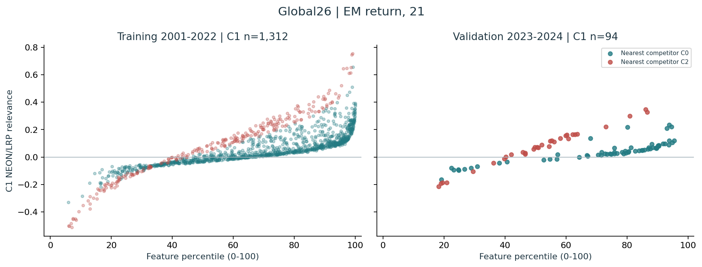

가로축 하위/상위 사분위는 해당 validation C1 표본 안에서 구했다. 다른 feature도 함께 움직인 관측 결과다.

**축과 표본**: Training 5,391개 값과 비교한 표시용 percentile이다. 모델에는 실제 수익률이 입력된다. 점 하나는 C1 하루다. 왼쪽 1,312일, 오른쪽 94일이며 세로축 범위는 같다. 색은 가장 가까운 경쟁 국면이다.

**관측 결과**: 기여 절댓값 평균은 training 0.115, validation 0.089, validation 26개 중 19위다. 부호 평균 +0.050, C1 지지 일수 비중 77.7%. 낮은/높은 percentile 사분위의 기여 중앙값은 -0.074/+0.087다.

**해석**: 실제 21일 단순수익률이 모델에 입력된다. 가로축 percentile은 training 값과 비교한 표시용 변환으로, 관측 수익률의 순서를 보존한다. 가장 가까운 입력은 EM - USA, 21, 이 C1 표본에서 correlation 0.773다.

## Global26 / EMU return, 21

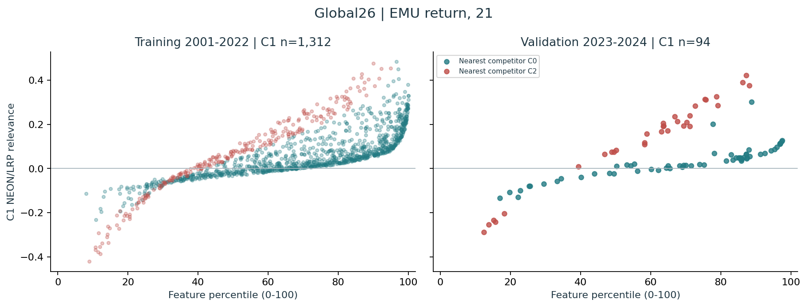

가로축 하위/상위 사분위는 해당 validation C1 표본 안에서 구했다. 다른 feature도 함께 움직인 관측 결과다.

**축과 표본**: Training 5,391개 값과 비교한 표시용 percentile이다. 모델에는 실제 수익률이 입력된다. 점 하나는 C1 하루다. 왼쪽 1,312일, 오른쪽 94일이며 세로축 범위는 같다. 색은 가장 가까운 경쟁 국면이다.

**관측 결과**: 기여 절댓값 평균은 training 0.099, validation 0.112, validation 26개 중 18위다. 부호 평균 +0.066, C1 지지 일수 비중 77.7%. 낮은/높은 percentile 사분위의 기여 중앙값은 -0.064/+0.086다.

**해석**: 실제 21일 단순수익률이 모델에 입력된다. 가로축 percentile은 training 값과 비교한 표시용 변환으로, 관측 수익률의 순서를 보존한다. 가장 가까운 입력은 VSTOXX, 이 C1 표본에서 correlation -0.587다.

## Global26 / Cyclical return, 5

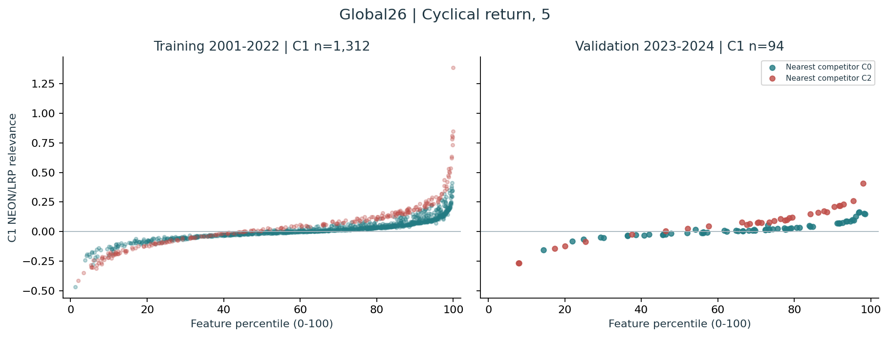

가로축 하위/상위 사분위는 해당 validation C1 표본 안에서 구했다. 다른 feature도 함께 움직인 관측 결과다.

**축과 표본**: Training 5,391개 값과 비교한 표시용 percentile이다. 모델에는 실제 수익률이 입력된다. 점 하나는 C1 하루다. 왼쪽 1,312일, 오른쪽 94일이며 세로축 범위는 같다. 색은 가장 가까운 경쟁 국면이다.

**관측 결과**: 기여 절댓값 평균은 training 0.084, validation 0.076, validation 26개 중 21위다. 부호 평균 +0.042, C1 지지 일수 비중 73.4%. 낮은/높은 percentile 사분위의 기여 중앙값은 -0.032/+0.151다.

**해석**: 실제 5일 단순수익률이 모델에 입력된다. 가로축 percentile은 training 값과 비교한 표시용 변환으로, 관측 수익률의 순서를 보존한다. 가장 가까운 입력은 EMU return, 5, 이 C1 표본에서 correlation 0.692다.

## Global26 / Defensive return, 5

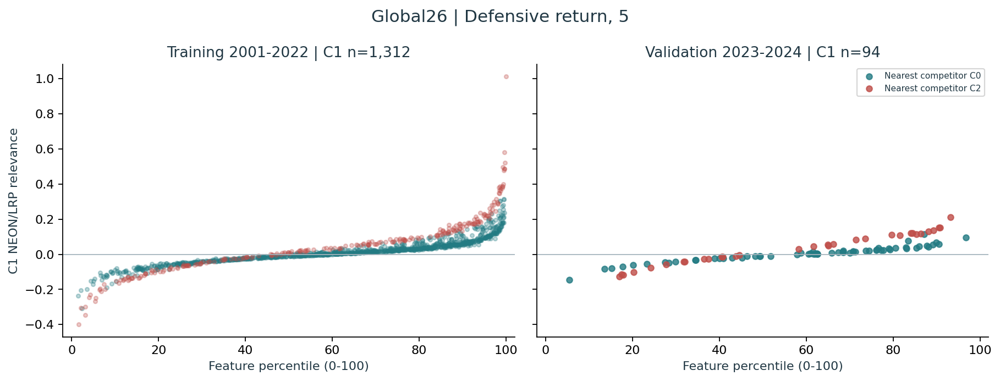

가로축 하위/상위 사분위는 해당 validation C1 표본 안에서 구했다. 다른 feature도 함께 움직인 관측 결과다.

**축과 표본**: Training 5,391개 값과 비교한 표시용 percentile이다. 모델에는 실제 수익률이 입력된다. 점 하나는 C1 하루다. 왼쪽 1,312일, 오른쪽 94일이며 세로축 범위는 같다. 색은 가장 가까운 경쟁 국면이다.

**관측 결과**: 기여 절댓값 평균은 training 0.068, validation 0.050, validation 26개 중 23위다. 부호 평균 +0.015, C1 지지 일수 비중 61.7%. 낮은/높은 percentile 사분위의 기여 중앙값은 -0.051/+0.102다.

**해석**: 실제 5일 단순수익률이 모델에 입력된다. 가로축 percentile은 training 값과 비교한 표시용 변환으로, 관측 수익률의 순서를 보존한다. 가장 가까운 입력은 EMU return, 5, 이 C1 표본에서 correlation 0.568다.

## Global26 / Japan return, 5

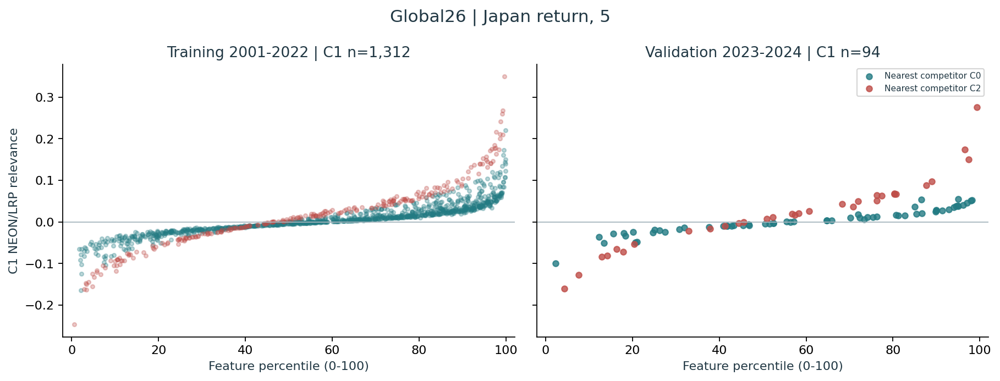

가로축 하위/상위 사분위는 해당 validation C1 표본 안에서 구했다. 다른 feature도 함께 움직인 관측 결과다.

**축과 표본**: Training 5,391개 값과 비교한 표시용 percentile이다. 모델에는 실제 수익률이 입력된다. 점 하나는 C1 하루다. 왼쪽 1,312일, 오른쪽 94일이며 세로축 범위는 같다. 색은 가장 가까운 경쟁 국면이다.

**관측 결과**: 기여 절댓값 평균은 training 0.034, validation 0.037, validation 26개 중 26위다. 부호 평균 +0.010, C1 지지 일수 비중 56.4%. 낮은/높은 percentile 사분위의 기여 중앙값은 -0.034/+0.039다.

**해석**: 실제 5일 단순수익률이 모델에 입력된다. 가로축 percentile은 training 값과 비교한 표시용 변환으로, 관측 수익률의 순서를 보존한다. 가장 가까운 입력은 Cyclical return, 5, 이 C1 표본에서 correlation 0.545다.

## Global26 / EM return, 5

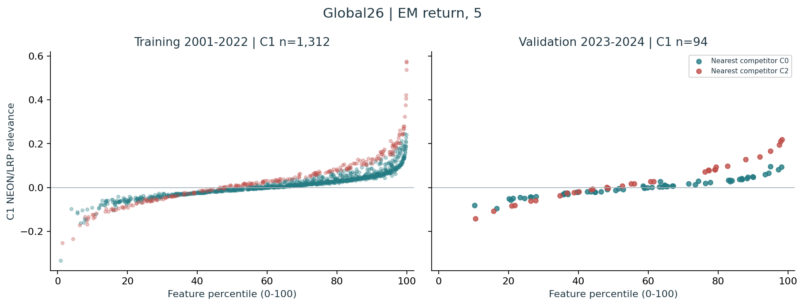

가로축 하위/상위 사분위는 해당 validation C1 표본 안에서 구했다. 다른 feature도 함께 움직인 관측 결과다.

**축과 표본**: Training 5,391개 값과 비교한 표시용 percentile이다. 모델에는 실제 수익률이 입력된다. 점 하나는 C1 하루다. 왼쪽 1,312일, 오른쪽 94일이며 세로축 범위는 같다. 색은 가장 가까운 경쟁 국면이다.

**관측 결과**: 기여 절댓값 평균은 training 0.052, validation 0.046, validation 26개 중 24위다. 부호 평균 +0.014, C1 지지 일수 비중 56.4%. 낮은/높은 percentile 사분위의 기여 중앙값은 -0.047/+0.055다.

**해석**: 실제 5일 단순수익률이 모델에 입력된다. 가로축 percentile은 training 값과 비교한 표시용 변환으로, 관측 수익률의 순서를 보존한다. 가장 가까운 입력은 EMU return, 5, 이 C1 표본에서 correlation 0.710다.

## Global26 / EMU return, 5

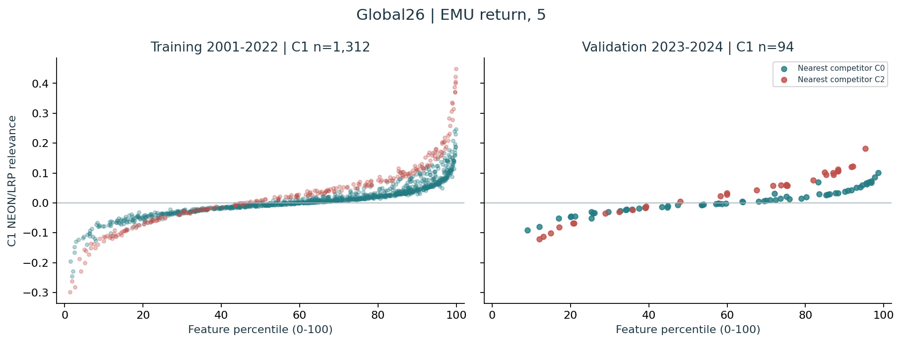

가로축 하위/상위 사분위는 해당 validation C1 표본 안에서 구했다. 다른 feature도 함께 움직인 관측 결과다.

**축과 표본**: Training 5,391개 값과 비교한 표시용 percentile이다. 모델에는 실제 수익률이 입력된다. 점 하나는 C1 하루다. 왼쪽 1,312일, 오른쪽 94일이며 세로축 범위는 같다. 색은 가장 가까운 경쟁 국면이다.

**관측 결과**: 기여 절댓값 평균은 training 0.049, validation 0.046, validation 26개 중 25위다. 부호 평균 +0.016, C1 지지 일수 비중 57.4%. 낮은/높은 percentile 사분위의 기여 중앙값은 -0.044/+0.069다.

**해석**: 실제 5일 단순수익률이 모델에 입력된다. 가로축 percentile은 training 값과 비교한 표시용 변환으로, 관측 수익률의 순서를 보존한다. 가장 가까운 입력은 EM return, 5, 이 C1 표본에서 correlation 0.710다.

## Feature inventory

| # | Exact identifier | Operator recipe | Squared weight |
| --- | --- | --- | --- |
| 1 | rank252__return__sp500__21d | rank252(return(sp500, 21)) | 0.250000 |
| 2 | rank252__return__nasdaq100__21d | rank252(return(nasdaq100, 21)) | 0.250000 |
| 3 | rank252__return__russell2000__21d | rank252(return(russell2000, 21)) | 0.250000 |
| 4 | rank252__return__ftse100__21d | rank252(return(ftse100, 21)) | 0.250000 |
| 5 | rank252__realized_vol__sp500__21d | rank252(volatility(sp500, 21)) | 0.200000 |
| 6 | rank252__realized_vol__nasdaq100__21d | rank252(volatility(nasdaq100, 21)) | 0.200000 |
| 7 | rank252__realized_vol__russell2000__21d | rank252(volatility(russell2000, 21)) | 0.200000 |
| 8 | rank252__level__vix | rank252(level(vix)) | 0.200000 |
| 9 | rank252__level__vstoxx | rank252(level(vstoxx)) | 0.200000 |
| 10 | rank252__corr__sp500__nasdaq100__21d | rank252(correlation(sp500, nasdaq100, 21)) | 0.333333 |
| 11 | rank252__corr__sp500__russell2000__21d | rank252(correlation(sp500, russell2000, 21)) | 0.333333 |
| 12 | rank252__corr__nasdaq100__russell2000__21d | rank252(correlation(nasdaq100, russell2000, 21)) | 0.333333 |
| 13 | rank252__msci_cyc_minus_def_return21 | rank252(spread(msci_cyclical, msci_defensive, 21)) | 0.333333 |
| 14 | rank252__msci_em_minus_us_return21 | rank252(spread(msci_em, msci_us, 21)) | 0.166667 |
| 15 | rank252__msci_japan_minus_emu_return21 | rank252(spread(msci_japan, msci_emu, 21)) | 0.166667 |
| 16 | rank252__msci_country_pc1share63 | rank252(pc1_share(msci_us, msci_uk, msci_japan, msci_canada, msci_australia, msci_germany, msci_france, msci_switzerland, 63)) | 0.333333 |
| 17 | msci_cyclical_absolute_return21 | return(msci_cyclical, 21) | 0.250000 |
| 18 | msci_defensive_absolute_return21 | return(msci_defensive, 21) | 0.250000 |
| 19 | msci_japan_absolute_return21 | return(msci_japan, 21) | 0.166667 |
| 20 | msci_em_absolute_return21 | return(msci_em, 21) | 0.166667 |
| 21 | msci_emu_absolute_return21 | return(msci_emu, 21) | 0.166667 |
| 22 | msci_cyclical_absolute_return5 | return(msci_cyclical, 5) | 0.125000 |
| 23 | msci_defensive_absolute_return5 | return(msci_defensive, 5) | 0.125000 |
| 24 | msci_japan_absolute_return5 | return(msci_japan, 5) | 0.083333 |
| 25 | msci_em_absolute_return5 | return(msci_em, 5) | 0.083333 |
| 26 | msci_emu_absolute_return5 | return(msci_emu, 5) | 0.083333 |

## Sources and operations

- [NEON original paper](https://arxiv.org/html/1906.07633v2#S2)
- [FMP stable historical EOD](https://site.financialmodelingprep.com/developer/docs/stable/historical-price-eod-full)
- [Cboe VIX daily data](https://cdn-api.cboe.com/api/global/us_indices/daily_prices/VIX_History.csv)
- [STOXX V2TX daily data](https://www.stoxx.com/document/Indices/Current/HistoricalData/h_v2tx.txt)
- [API and operations](../API.md)
- [Version policy](../VERSIONING.md)
- [Validation evidence](../validation/replay.json)
