# ECCLES v1.0 model report

Global26 + NEON/LRP | 2026-11-10 | Latest complete observation: 2026-11-06

## Model v1.0: Global26 + NEON

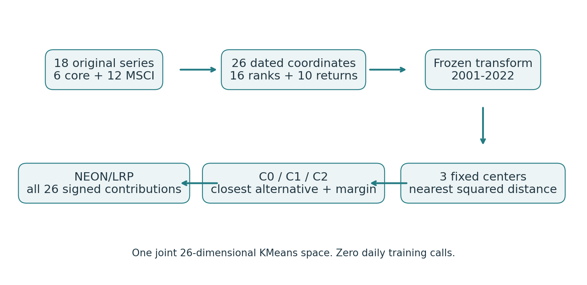

Source artifact SHA256: 35c632a96524202099c1b5b0d9ad69a37e467eb8145f1a5eb967a98d9584a98b

**Adopted base**: The user selected frozen Global26 KMeans plus direct NEON/LRP as model v1.0 on November 10, 2026. B12 remains a historical comparison. Daily decisions use the saved nearest-center rule.

**What one day means**: Each complete US session becomes one point with 26 coordinates. The closest of three fixed centers supplies C0, C1 or C2. NEON rewrites the same comparisons and explains their winning margin.

**Freeze boundary**: Training uses 5,391 complete dates in 2001-2022. Scalers, weights, centers and beta are fixed. The daily service computes new inputs without refitting.

**Scope**: This release describes contemporaneous equity conditions. It presents direction, co-movement and leadership together. 2023-2024 and the examined 2026 results remain development evidence.

## Inputs and distance geometry

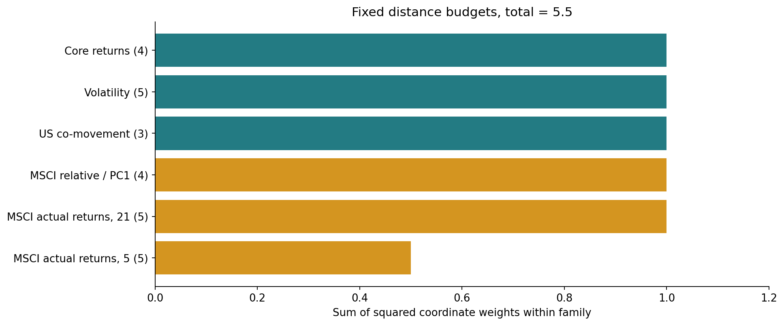

Exact operators, source identifiers, weights and formulas are in model.json and the feature inventory.

**Original sources**: FMP supplies S&P 500, Nasdaq 100 and FTSE 100; Yahoo supplies the original Russell 2000; Cboe supplies VIX; STOXX supplies V2TX. Twelve MSCI USD STRD price indices supply the added coordinates.

**Transform**: The first 16 coordinates are current-inclusive trailing-252 observation ranks. The final 10 retain actual 5/21-session returns. All 26 are standardized with training means/scales, then multiplied by fixed weights.

**Read the bars**: A family budget is the sum of squared weights. A larger budget increases distance sensitivity for equal standardized changes. This is one joint clustering with researcher-specified geometry.

**Calendars**: FTSE returns use native UK sessions; VSTOXX ranks use published observations. MSCI levels align to US sessions before computing returns. Required missing inputs remain missing.

## Core equity profiles

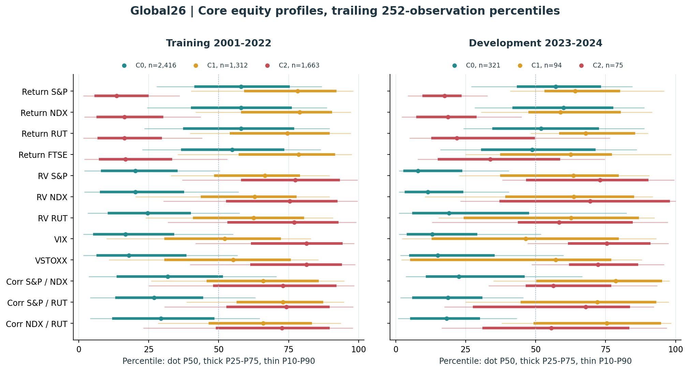

Both panels use the same ordering and scale. n counts dates; serially related observations remain.

**Construction**: Group daily feature ranks by each model’s own state. Training is 2001-2022; 2023-2024 is the already-examined development period.

**Marks**: Horizontal scale: current-inclusive trailing-252 percentile. Dot: median, thick line: P25-P75, thin line: P10-P90. Overlap shows that one coordinate alone cannot separate the groups.

**Observed direction**: S&P return C0/C1/C2 medians: training 57.9/78.2/13.5, development 57.1/64.1/17.5. C1/C2 ordering persists.

**C0 versus C1**: Development S&P/Russell correlation medians: 18.7/72.0/67.9. Co-movement separates C0/C1 more clearly than return alone. Read raw returns for their sign.

## Added relative and structure features

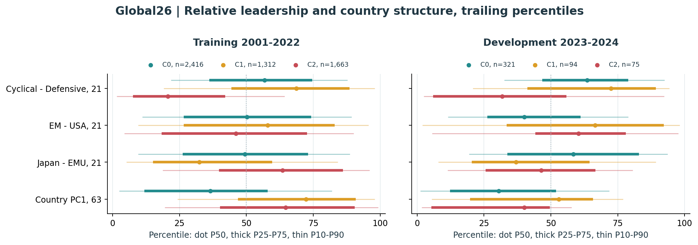

Eight countries: USA, UK, Japan, Canada, Australia, Germany, France and Switzerland. Original MSCI USD STRD price indexes.

**Four added coordinates**: 21-session return spreads: Cyclical minus Defensive, EM minus USA and Japan minus EMU; plus a 63-session country PC1 share.

**Transform**: All four use trailing-252 ranks. PC1 share is the largest eigenvalue divided by the trace of the eight-country return correlation matrix over 63 US sessions.

**Repeatable separation**: Cyclical-Defensive medians C0/C1/C2 are 56.7/68.7/20.6 in training and 63.5/72.4/31.7 in development. Leadership helps distinguish weak from rising conditions.

**Rank versus level**: C0 PC1 rank is below C1, but raw development medians are 0.608 versus 0.579. Rolling reference windows differ. Regional spreads have overlapping and changing state ordering.

## Added actual-return features

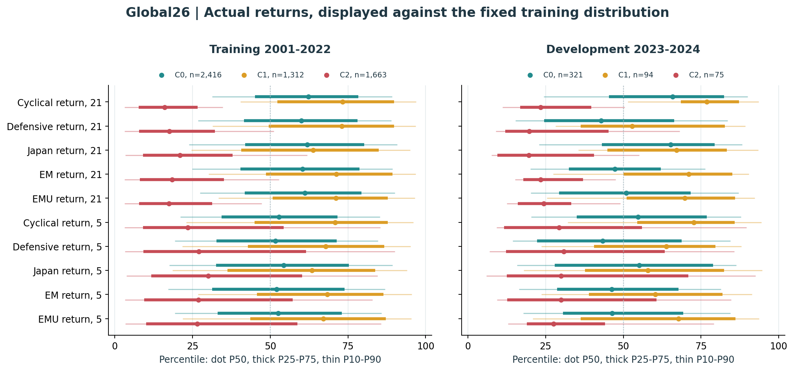

Return = P(t)/P(t-h)-1, with a complete h+1-observation price window. No local imputation.

**Why actual returns**: A negative return can still have a high trailing rank. Ten actual 5/21-session returns retain direction and magnitude for Cyclical, Defensive, Japan, EM and EMU.

**Display only**: The model standardizes actual returns. For this figure only, values are mapped to the fixed 2001-2022 training distribution. This percentile uses a different reference from trailing ranks.

**Directional evidence**: Development Cyclical 21-session medians are +2.7%, +3.7%, -2.5% for C0/C1/C2; EM medians are +0.6%, +4.0%, -3.2%.

**Persistent overlap**: Japan medians are close for C0 and C1, +2.1% versus +2.4%. Five- and 21-session returns share the same source, so their redundancy needs explicit review.

## Correlation between features

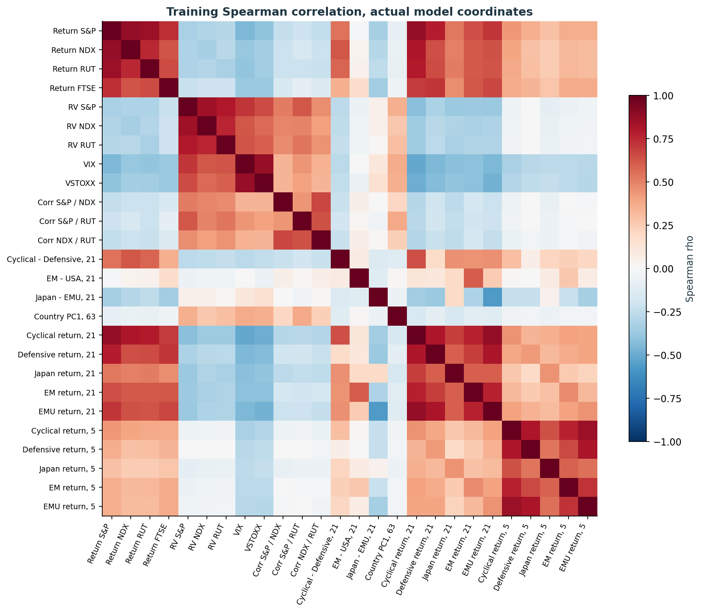

Matrix uses 5,391 training dates. Development/2026 matrices and closest-feature tables are saved alongside it.

**How to read**: Rows and columns are model coordinates. Red means positive rank association, blue negative, white weak. The diagonal equals one.

**Observed overlap**: S&P return rank versus Cyclical actual 21-session return: 0.879; Cyclical versus EMU actual 21-session return: 0.876 in training.

**Fixed metric**: Squared budgets: original return/volatility/co-movement 1 each, added relative/structure 1, actual 21-session returns 1, actual 5-session returns 0.5. Total 5.5.

**Retention**: Removing Cyclical21 lost three persuasive readings in the prior comparison. Keep it while recording the remaining duplication.

## 2026 labels on index prices

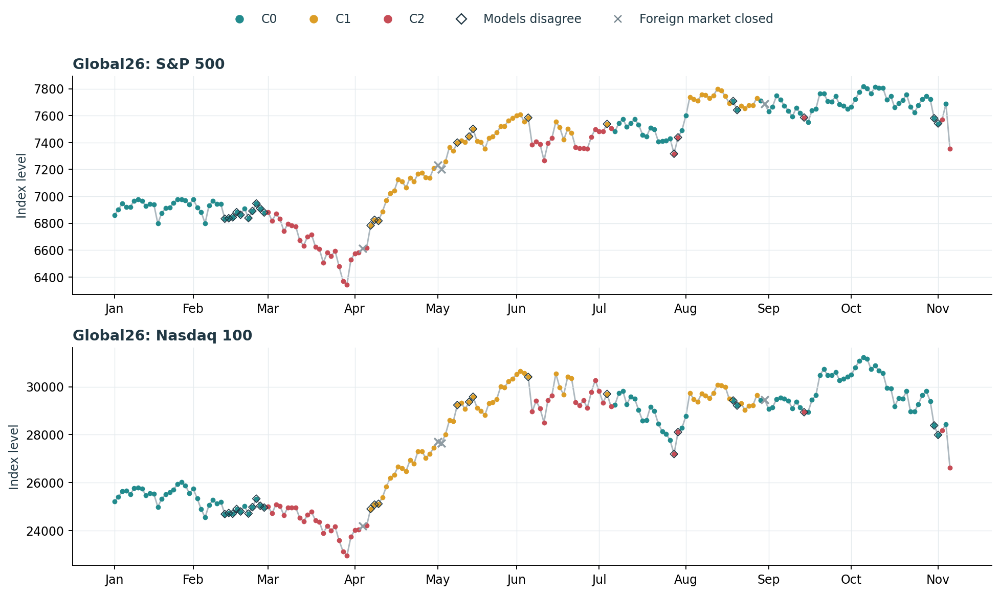

Grey crosses indicate foreign-market closures and no assigned state. All 25 case readings remain in the prior comparison.

**Read the path**: Actual S&P 500 and Nasdaq 100 closes carry the same Global26 state series. Black diamonds mark disagreements with the other model.

**Observed behavior**: March stress remains C2; some April recovery becomes C1. February C0 adds US/foreign differentiation.

**Counterexample**: May 13: Nasdaq21 +13.64% but only 2/8 countries rising. Global26 C1 overstates breadth; B12 C0 better describes global dispersion.

**Denominator**: The models differ on 25/209 complete 2026 dates, 12.0%. Judge contemporary direction, breadth and risk; switching and subsequent returns do not select the winner.

## Why Global26 was selected

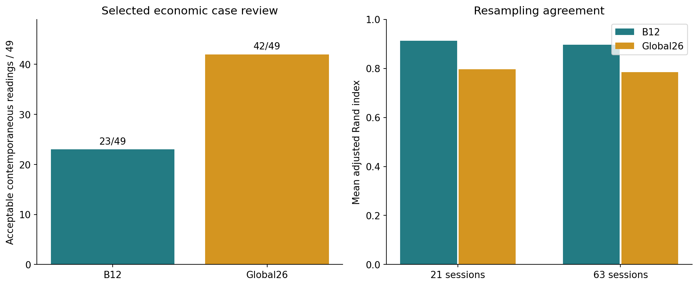

Reviewed economic fit and resampling stability measure different properties. Previously examined observations remain exposed.

**Economic descriptions**: The reviewed 49 disagreements were checked against prewritten acceptable contemporaneous readings. Global26 matched 42/49 and B12 23/49. These cases informed selection; seven Global26 failures remain.

**Stability cost**: Mean resampling ARI is 0.797/0.784 for Global26 versus 0.912/0.897 for B12, using 21/63-session blocks. Each length includes 120 fits across four training cutoffs. Lower values show greater sample sensitivity.

**Specific counterexample**: On May 13, 2026, Nasdaq 21-session return was +13.64% while only 2/8 country indices were rising. Global26 C1 overstates global breadth; B12 C0 better describes that dispersion.

**Working labels**: C0: differentiated/lower co-movement. C1: synchronized upswing. C2: weak/stressed. Read each label with raw direction, participation and competing contributions. Switching frequency was excluded from feature selection.

## How NEON explains the frozen decision

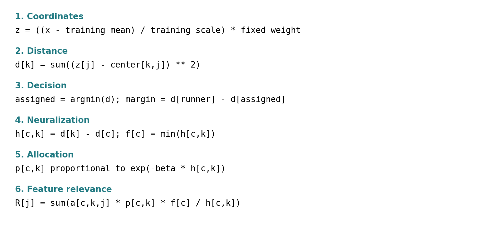

Kauffmann et al., NEON, arXiv:1906.07633v2, section II. At an exact decision tie the service reports an undefined assigned-class LRP.

**Same classifier**: Squared-distance differences are linear in the transformed coordinates. A linear comparison layer and minimum pooling reproduce the original nearest-center classifier. Daily service inference has no XGBoost surrogate.

**Explain one assigned class**: For the selected class c, compare both other centers k. The smallest advantage is its margin f[c]. Directional LRP allocates that margin through both comparisons and then to the 26 coordinates.

**Signed evidence**: a[c,k,j] = (z[j] - (center[c,j]+center[k,j])/2) * 2*(center[c,j]-center[k,j]). Positive relevance supports the assigned class, negative relevance offsets it. Their signed sum equals the margin.

**Interpretation choice**: Beta=0.2660534496, inverse mean training margin. Alternative beta values preserve labels but change attribution. Correlated coordinates retain their overlap; economic usefulness is assessed using cases and controlled feature-removal tests.

## Latest complete observation: 2026-11-06

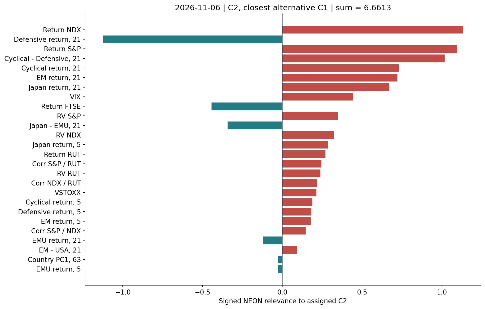

All 26 contributions are shown. Bar sign refers to support for C2, not the sign of a market return.

**Decision and proximity**: C2 is closest: squared distances C0 14.926, C1 12.411, C2 5.750. Margin 6.6613, normalized gap 0.367.

**What supports C2**: Nasdaq return rank +1.132, S&P return rank +1.095, Cyclical-Defensive rank +1.018. Actual Nasdaq21 is -12.16%, S&P21 -5.00%, Cyclical21 -6.57% and EM21 -11.55%.

**What pushes back**: Defensive21 is +6.55% and contributes -1.124 against C2. FTSE21 +2.23% contributes -0.444. C2 therefore contains defensive leadership and regional dispersion.

**Availability**: Collected November 10. Seventeen sources include November 9; the official Cboe daily VIX file ends November 6. November 9 is withheld, and the API exposes missing_inputs with the retained November 6 result.

## Read percentiles and confidence separately

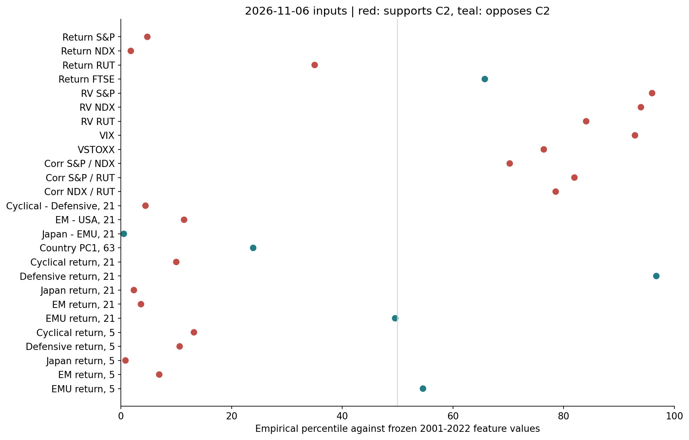

Same-class reference: 1,663 training C2 days. Percentiles and allocation weights are descriptive scores.

**What the horizontal axis measures**: For each current model input, count the fraction of the 5,391 training values below it, sharing ties equally. This chart uses a fixed training reference for every coordinate; the underlying rank feature has its own rolling reference.

**Observed values**: Nasdaq return is at training percentile 1.8, S&P 4.8, Cyclical-Defensive 4.5, Defensive21 96.8. This combination supports equity stress with strong defensive relative leadership.

**Margin and distance**: C2 margin is at the 61.0th percentile of training C2 margins. C2 distance is at percentile 85.6. Boundary flag is false, frozen atypical-distance flag is false, and all 26 coordinates remain within training ranges.

**Different questions**: Feature percentile describes an input level. Margin percentile describes separation from the nearest alternative. Distance percentile describes similarity to the assigned center. Read all three with their stated reference sample.

## Global26: what the added features contribute

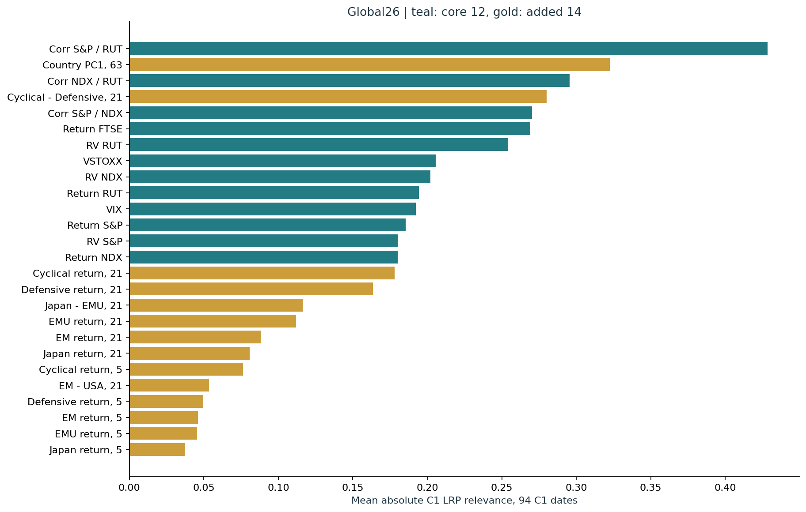

Do not read absolute relevance as positive support. Centers and score units differ between the two models.

**Construction**: Bars show mean absolute assigned-C1 relevance on Global26’s 94 validation C1 dates. Gold marks the fourteen added coordinates. The cohort differs from B12’s 77 C1 dates.

**Result**: Country PC1 is second (0.323) and Cyclical minus Defensive return is fourth (0.280). Their signed means are -0.078 and +0.096. Country PC1 frequently resists C1 even though it has high contribution magnitude.

**Interpretation**: Global synchronization and sector leadership alter the balance of evidence. Country PC1’s signed mean changes from +0.170 in training to -0.078 in validation. C1 contains less globally synchronized observations in the later sample. Five-session absolute returns have smaller per-coordinate roles.

## Release verification

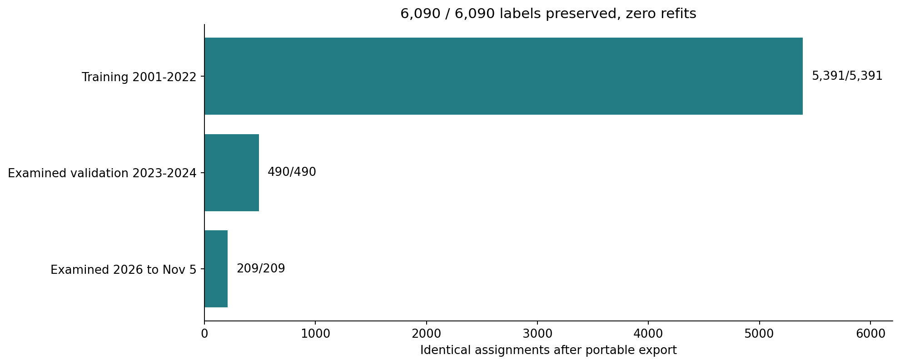

Numerical equivalence gates use absolute/relative tolerance 1e-9. Detailed JSON/XML evidence accompanies the release.

**Frozen outputs**: All 6,090 classifications match the retained Global26. Maximum distance error is 7.11e-15, relevance error 4.44e-16, and signed relevance-sum error 2.13e-14.

**Independent input construction**: Rebuilt 26 features from saved original-source snapshots. Across 6,037 historical rows and 209 examined 2026 rows, missing-value patterns and all complete assignments agree. Maximum feature error is 4.31e-16.

**Service behavior**: Eighteen automated checks cover authentication, immutable publication, protected 2025 warmup, completed-session clocks, missing-input handling, bundle corruption, path safety, writer exclusion, activation and rollback.

**Resource record**: Replay peak RSS 173.5 MiB; feature rebuild 132.0 MiB; service tests 114.1 MiB. One numerical thread. Daily container memory limit 1 GiB and API limit 512 MiB.

## Daily API and replaceable models

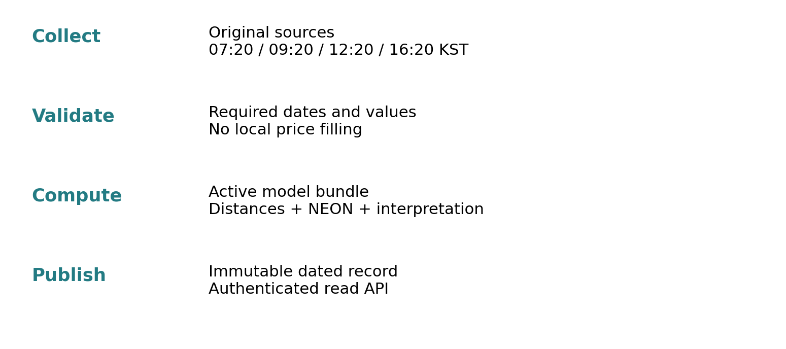

Supported operators permit bundle-only upgrades. New operators need a compatible engine update. The server API and timer are active. Original-source refresh and authenticated responses are verified. Latest status is in docs/DEPLOYMENT.md.

**Daily schedule**: Collection is configured for 07:20, 09:20, 12:20 and 16:20 KST, Monday through Saturday. A US session is eligible after its scheduled close plus 90 minutes. Later runs retry delayed providers.

**Publication contract**: The API returns model version/hash, US as-of date, source snapshot identity, C0/C1/C2, closest alternative, all distances, percentiles, 26 NEON contributions and deterministic English/Korean interpretation.

**Missing and revised inputs**: Incomplete dates are withheld. The last valid date remains visible with source-level missing/stale status. Already-published version/date records are immutable; observed revisions are logged separately.

**Model replacement**: Validate a new bundle, refresh that version through the active model date, then atomically activate it. The service reads the active pointer without restart. Prior bundles and dated records remain available for rollback.

## Version policy and next research

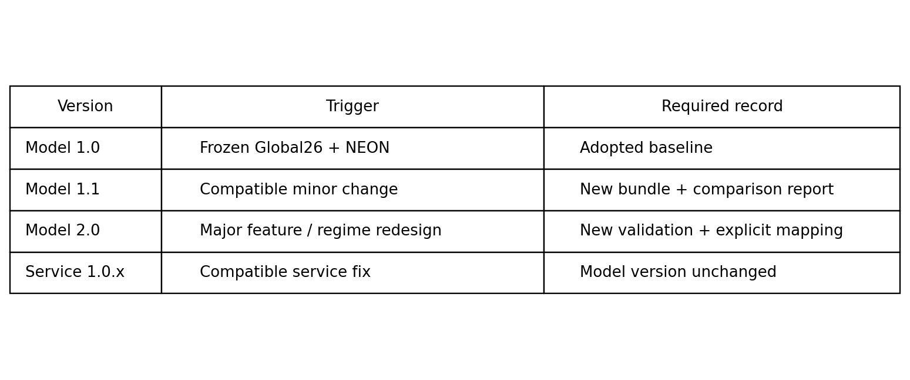

No automatic refit or automatic promotion. The adopted bundle remains reproducible.

**Major version**: Substantial feature additions/removals, source identities, target regime meaning or clustering geometry changes create v2.0. Keep the previous version active until the replacement has a dated comparison and an adoption decision.

**Minor version**: Small compatible model/interpretation changes create v1.1 and still require a new immutable bundle, reproducibility checks and a recorded comparison. Any change that alters labels is visible in the release report.

**Separate service code**: API bug fixes or operational changes that preserve model outputs increment the service patch version. Store both model and service versions with each result. API paths have their own /v1 contract.

**Next research**: Review overlapping co-movement and return families with controlled ablations. Revisit C1 naming using direction and participation. Macro selection and temporal processing remain separate experiments; v1.0 stays frozen during research.

## Global26 / Return S&P

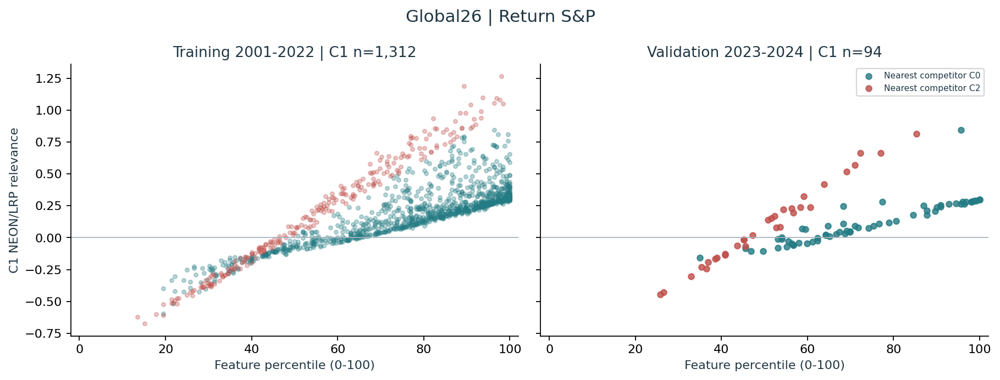

Feature: rank252__return__sp500__21d. Low/high quartiles are formed within each validation C1 feature distribution; other inputs vary.

**Axes**: Trailing 252-observation rank x 100. Each dot is an assigned-C1 date. Left n=1312, right n=94. Shared vertical scale. Color identifies the nearest competitor.

**Observed role**: Mean absolute relevance: training 0.270, validation 0.185 (rank 12/26). Validation signed mean +0.110; 67.0% of dates support C1. Low/high percentile-quartile median relevance: -0.105/+0.266.

**Interpretation**: This is the trailing-252 rank of a 21-session simple return. A high percentile means stronger than its own recent history; the underlying return may still be negative. Closest input overlap: Cyclical return, 21, rho 0.888 on this C1 sample.

## Global26 / Return NDX

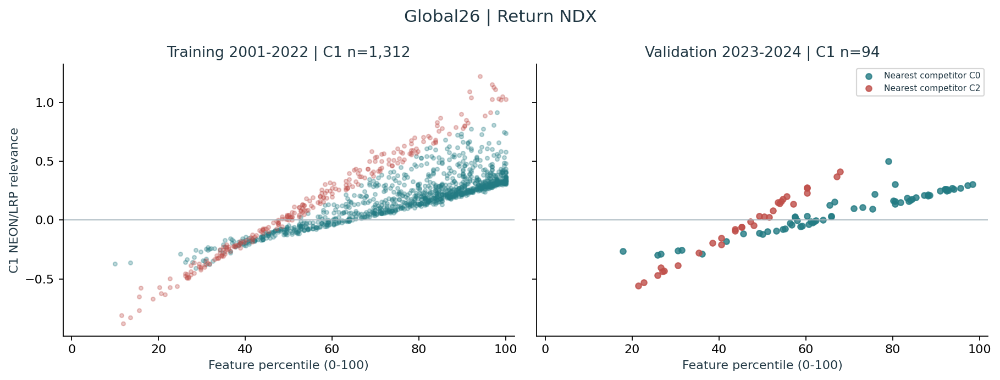

Feature: rank252__return__nasdaq100__21d. Low/high quartiles are formed within each validation C1 feature distribution; other inputs vary.

**Axes**: Trailing 252-observation rank x 100. Each dot is an assigned-C1 date. Left n=1312, right n=94. Shared vertical scale. Color identifies the nearest competitor.

**Observed role**: Mean absolute relevance: training 0.265, validation 0.180 (rank 14/26). Validation signed mean +0.027; 56.4% of dates support C1. Low/high percentile-quartile median relevance: -0.261/+0.233.

**Interpretation**: This is the trailing-252 rank of a 21-session simple return. A high percentile means stronger than its own recent history; the underlying return may still be negative. Closest input overlap: Return S&P, rho 0.884 on this C1 sample.

## Global26 / Return RUT

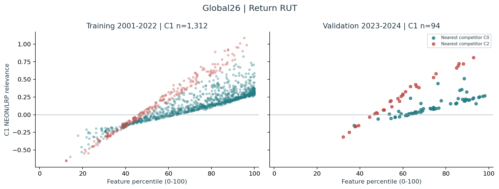

Feature: rank252__return__russell2000__21d. Low/high quartiles are formed within each validation C1 feature distribution; other inputs vary.

**Axes**: Trailing 252-observation rank x 100. Each dot is an assigned-C1 date. Left n=1312, right n=94. Shared vertical scale. Color identifies the nearest competitor.

**Observed role**: Mean absolute relevance: training 0.227, validation 0.194 (rank 10/26). Validation signed mean +0.163; 84.0% of dates support C1. Low/high percentile-quartile median relevance: +0.009/+0.242.

**Interpretation**: This is the trailing-252 rank of a 21-session simple return. A high percentile means stronger than its own recent history; the underlying return may still be negative. Closest input overlap: Return S&P, rho 0.544 on this C1 sample.

## Global26 / Return FTSE

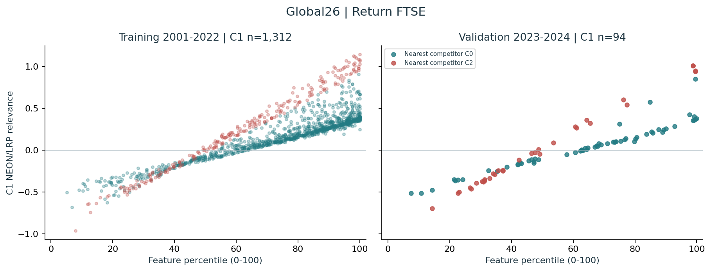

Feature: rank252__return__ftse100__21d. Low/high quartiles are formed within each validation C1 feature distribution; other inputs vary.

**Axes**: Trailing 252-observation rank x 100. Each dot is an assigned-C1 date. Left n=1312, right n=94. Shared vertical scale. Color identifies the nearest competitor.

**Observed role**: Mean absolute relevance: training 0.295, validation 0.269 (rank 6/26). Validation signed mean +0.026; 52.1% of dates support C1. Low/high percentile-quartile median relevance: -0.363/+0.358.

**Interpretation**: This is the trailing-252 rank of a 21-session simple return. A high percentile means stronger than its own recent history; the underlying return may still be negative. Closest input overlap: Defensive return, 21, rho 0.579 on this C1 sample.

## Global26 / RV S&P

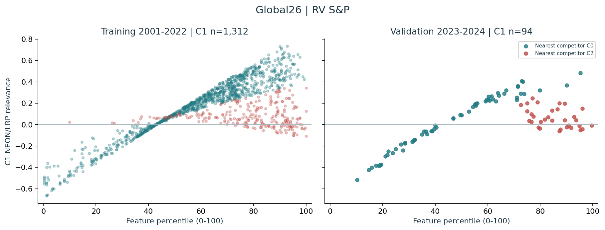

Feature: rank252__realized_vol__sp500__21d. Low/high quartiles are formed within each validation C1 feature distribution; other inputs vary.

**Axes**: Trailing 252-observation rank x 100. Each dot is an assigned-C1 date. Left n=1312, right n=94. Shared vertical scale. Color identifies the nearest competitor.

**Observed role**: Mean absolute relevance: training 0.239, validation 0.180 (rank 13/26). Validation signed mean +0.044; 57.4% of dates support C1. Low/high percentile-quartile median relevance: -0.235/+0.040.

**Interpretation**: This is 21-session realized volatility. Low volatility can favor calm C0; comparison with stressed C2 can reverse the contribution. Read the competitor colors. Closest input overlap: RV NDX, rho 0.956 on this C1 sample.

## Global26 / RV NDX

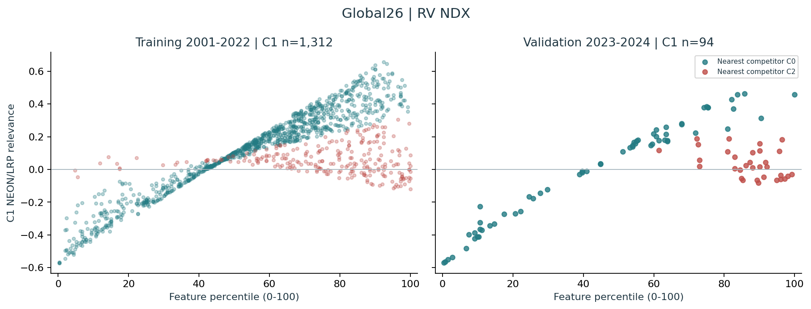

Feature: rank252__realized_vol__nasdaq100__21d. Low/high quartiles are formed within each validation C1 feature distribution; other inputs vary.

**Axes**: Trailing 252-observation rank x 100. Each dot is an assigned-C1 date. Left n=1312, right n=94. Shared vertical scale. Color identifies the nearest competitor.

**Observed role**: Mean absolute relevance: training 0.210, validation 0.202 (rank 9/26). Validation signed mean +0.015; 58.5% of dates support C1. Low/high percentile-quartile median relevance: -0.354/+0.017.

**Interpretation**: This is 21-session realized volatility. Low volatility can favor calm C0; comparison with stressed C2 can reverse the contribution. Read the competitor colors. Closest input overlap: RV S&P, rho 0.956 on this C1 sample.

## Global26 / RV RUT

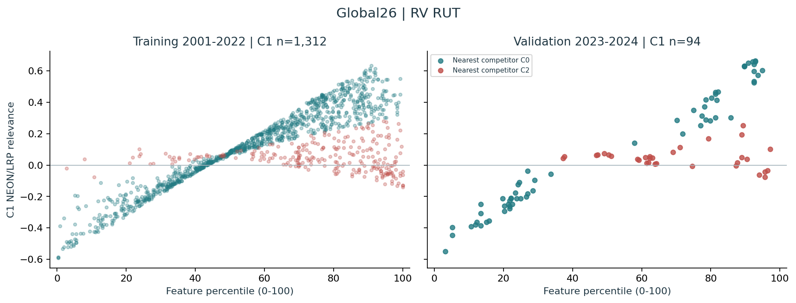

Feature: rank252__realized_vol__russell2000__21d. Low/high quartiles are formed within each validation C1 feature distribution; other inputs vary.

**Axes**: Trailing 252-observation rank x 100. Each dot is an assigned-C1 date. Left n=1312, right n=94. Shared vertical scale. Color identifies the nearest competitor.

**Observed role**: Mean absolute relevance: training 0.205, validation 0.254 (rank 7/26). Validation signed mean +0.075; 59.6% of dates support C1. Low/high percentile-quartile median relevance: -0.270/+0.528.

**Interpretation**: This is 21-session realized volatility. Low volatility can favor calm C0; comparison with stressed C2 can reverse the contribution. Read the competitor colors. Closest input overlap: EM - USA, 21, rho -0.569 on this C1 sample.

## Global26 / VIX

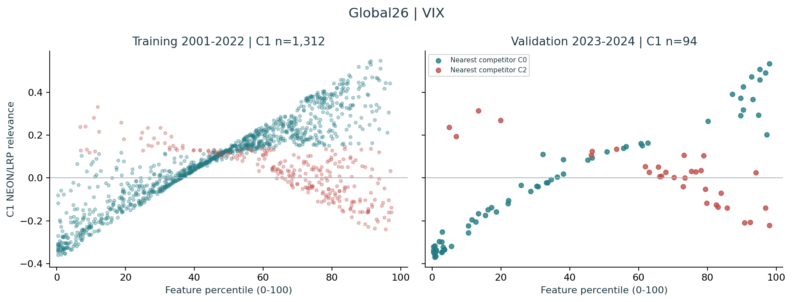

Feature: rank252__level__vix. Low/high quartiles are formed within each validation C1 feature distribution; other inputs vary.

**Axes**: Trailing 252-observation rank x 100. Each dot is an assigned-C1 date. Left n=1312, right n=94. Shared vertical scale. Color identifies the nearest competitor.

**Observed role**: Mean absolute relevance: training 0.158, validation 0.192 (rank 11/26). Validation signed mean -0.010; 50.0% of dates support C1. Low/high percentile-quartile median relevance: -0.322/+0.278.

**Interpretation**: This is the implied-volatility level rank. Its role separates calm C0, active C1 and stressed C2, so a single monotone risk interpretation misses the comparison context. Closest input overlap: VSTOXX, rho 0.909 on this C1 sample.

## Global26 / VSTOXX

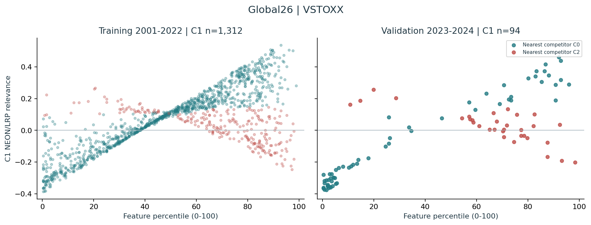

Feature: rank252__level__vstoxx. Low/high quartiles are formed within each validation C1 feature distribution; other inputs vary.

**Axes**: Trailing 252-observation rank x 100. Each dot is an assigned-C1 date. Left n=1312, right n=94. Shared vertical scale. Color identifies the nearest competitor.

**Observed role**: Mean absolute relevance: training 0.163, validation 0.206 (rank 8/26). Validation signed mean -0.035; 48.9% of dates support C1. Low/high percentile-quartile median relevance: -0.332/+0.238.

**Interpretation**: This is the implied-volatility level rank. Its role separates calm C0, active C1 and stressed C2, so a single monotone risk interpretation misses the comparison context. Closest input overlap: VIX, rho 0.909 on this C1 sample.

## Global26 / Corr S&P / NDX

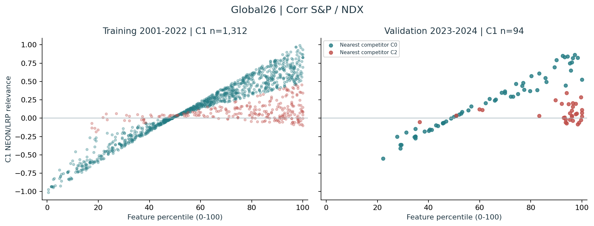

Feature: rank252__corr__sp500__nasdaq100__21d. Low/high quartiles are formed within each validation C1 feature distribution; other inputs vary.

**Axes**: Trailing 252-observation rank x 100. Each dot is an assigned-C1 date. Left n=1312, right n=94. Shared vertical scale. Color identifies the nearest competitor.

**Observed role**: Mean absolute relevance: training 0.317, validation 0.270 (rank 5/26). Validation signed mean +0.168; 67.0% of dates support C1. Low/high percentile-quartile median relevance: -0.164/+0.102.

**Interpretation**: This measures whether daily returns move together over 21 sessions. Its C1 contribution depends on both correlation rank and the competing cluster. Closest input overlap: RV NDX, rho 0.738 on this C1 sample.

## Global26 / Corr S&P / RUT

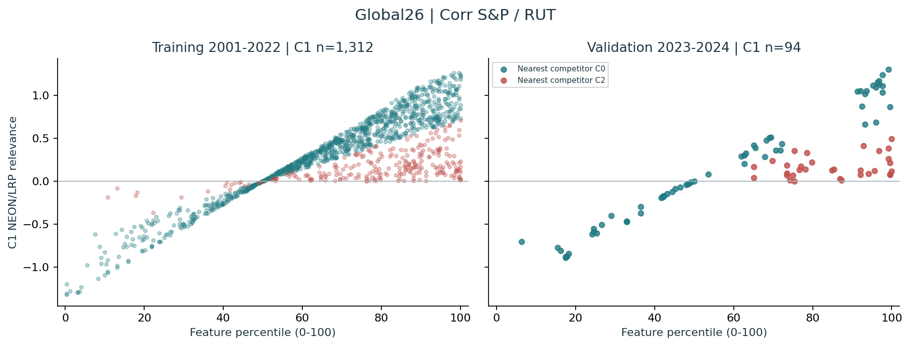

Feature: rank252__corr__sp500__russell2000__21d. Low/high quartiles are formed within each validation C1 feature distribution; other inputs vary.

**Axes**: Trailing 252-observation rank x 100. Each dot is an assigned-C1 date. Left n=1312, right n=94. Shared vertical scale. Color identifies the nearest competitor.

**Observed role**: Mean absolute relevance: training 0.452, validation 0.428 (rank 1/26). Validation signed mean +0.166; 68.1% of dates support C1. Low/high percentile-quartile median relevance: -0.488/+0.776.

**Interpretation**: This measures whether daily returns move together over 21 sessions. Its C1 contribution depends on both correlation rank and the competing cluster. Closest input overlap: Corr NDX / RUT, rho 0.952 on this C1 sample.

## Global26 / Corr NDX / RUT

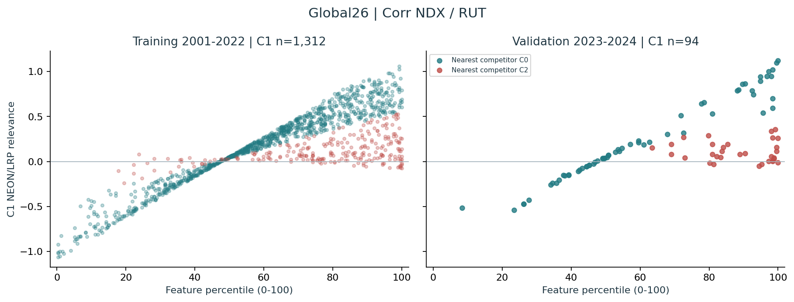

Feature: rank252__corr__nasdaq100__russell2000__21d. Low/high quartiles are formed within each validation C1 feature distribution; other inputs vary.

**Axes**: Trailing 252-observation rank x 100. Each dot is an assigned-C1 date. Left n=1312, right n=94. Shared vertical scale. Color identifies the nearest competitor.

**Observed role**: Mean absolute relevance: training 0.335, validation 0.296 (rank 3/26). Validation signed mean +0.197; 71.3% of dates support C1. Low/high percentile-quartile median relevance: -0.147/+0.338.

**Interpretation**: This measures whether daily returns move together over 21 sessions. Its C1 contribution depends on both correlation rank and the competing cluster. Closest input overlap: Corr S&P / RUT, rho 0.952 on this C1 sample.

## Global26 / Cyclical - Defensive, 21

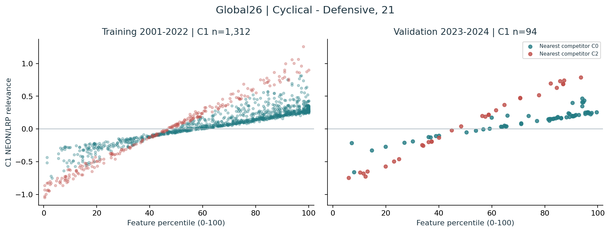

Feature: rank252__msci_cyc_minus_def_return21. Low/high quartiles are formed within each validation C1 feature distribution; other inputs vary.

**Axes**: Trailing 252-observation rank x 100. Each dot is an assigned-C1 date. Left n=1312, right n=94. Shared vertical scale. Color identifies the nearest competitor.

**Observed role**: Mean absolute relevance: training 0.250, validation 0.280 (rank 4/26). Validation signed mean +0.096; 70.2% of dates support C1. Low/high percentile-quartile median relevance: -0.249/+0.240.

**Interpretation**: This ranks the 21-session Cyclical minus Defensive return spread. It represents sector leadership, which can differ from the broad market direction. Closest input overlap: Corr S&P / NDX, rho -0.727 on this C1 sample.

## Global26 / EM - USA, 21

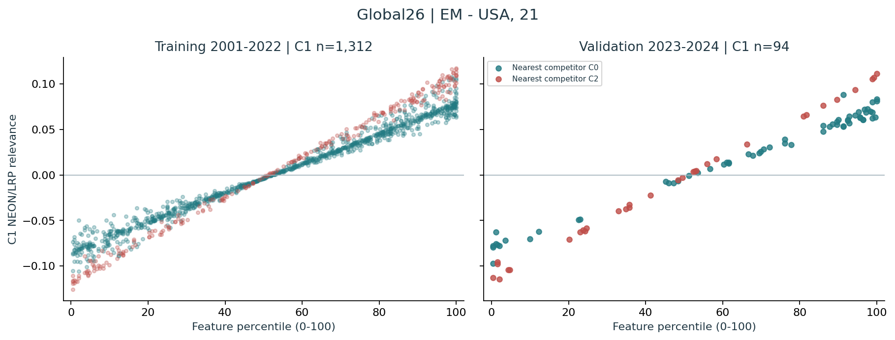

Feature: rank252__msci_em_minus_us_return21. Low/high quartiles are formed within each validation C1 feature distribution; other inputs vary.

**Axes**: Trailing 252-observation rank x 100. Each dot is an assigned-C1 date. Left n=1312, right n=94. Shared vertical scale. Color identifies the nearest competitor.

**Observed role**: Mean absolute relevance: training 0.048, validation 0.054 (rank 22/26). Validation signed mean +0.011; 62.8% of dates support C1. Low/high percentile-quartile median relevance: -0.074/+0.069.

**Interpretation**: This ranks EM minus USA 21-session returns. It adds relative geographic leadership; its contribution magnitude is small compared with synchronization features. Closest input overlap: EM return, 21, rho 0.773 on this C1 sample.

## Global26 / Japan - EMU, 21

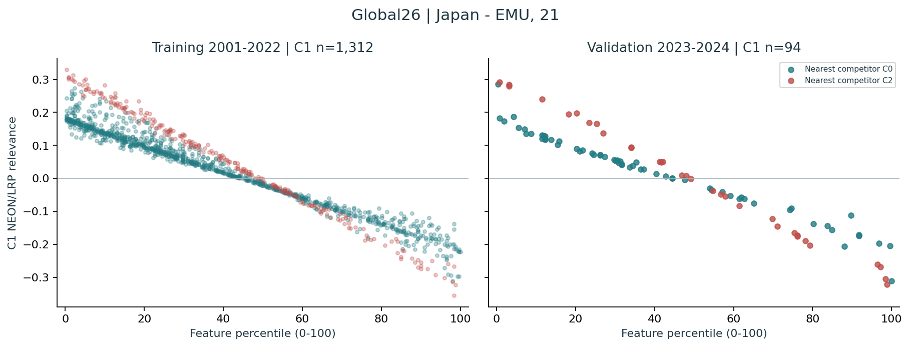

Feature: rank252__msci_japan_minus_emu_return21. Low/high quartiles are formed within each validation C1 feature distribution; other inputs vary.

**Axes**: Trailing 252-observation rank x 100. Each dot is an assigned-C1 date. Left n=1312, right n=94. Shared vertical scale. Color identifies the nearest competitor.

**Observed role**: Mean absolute relevance: training 0.113, validation 0.116 (rank 17/26). Validation signed mean +0.011; 60.6% of dates support C1. Low/high percentile-quartile median relevance: +0.142/-0.173.

**Interpretation**: This ranks Japan minus EMU 21-session returns. The observed negative slope reflects EMU-relative leadership in this frozen C1 center configuration. Closest input overlap: VSTOXX, rho 0.586 on this C1 sample.

## Global26 / Country PC1, 63

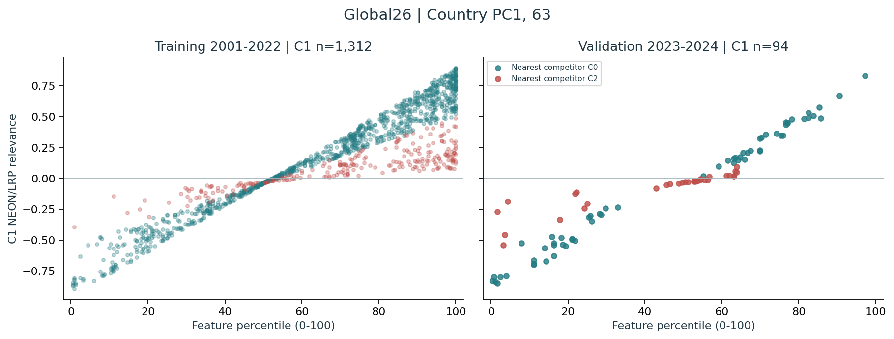

Feature: rank252__msci_country_pc1share63. Low/high quartiles are formed within each validation C1 feature distribution; other inputs vary.

**Axes**: Trailing 252-observation rank x 100. Each dot is an assigned-C1 date. Left n=1312, right n=94. Shared vertical scale. Color identifies the nearest competitor.

**Observed role**: Mean absolute relevance: training 0.349, validation 0.323 (rank 2/26). Validation signed mean -0.078; 43.6% of dates support C1. Low/high percentile-quartile median relevance: -0.555/+0.441.

**Interpretation**: Country PC1 measures the share of country-return variation explained by one component over 63 US sessions. Higher values indicate factor concentration; opposite-signed country loadings are possible. Read return signs alongside it. Closest input overlap: EM return, 21, rho 0.425 on this C1 sample.

## Global26 / Cyclical return, 21

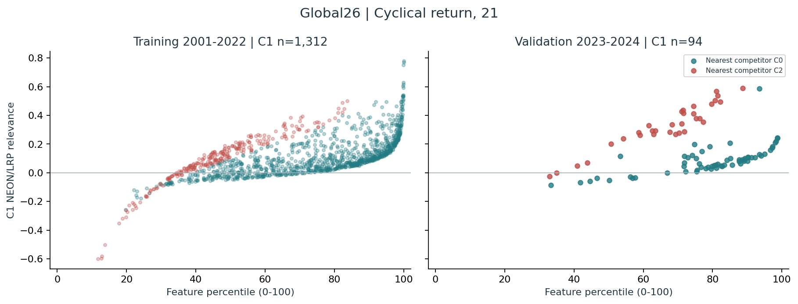

Feature: msci_cyclical_absolute_return21. Low/high quartiles are formed within each validation C1 feature distribution; other inputs vary.

**Axes**: Display percentile against all 5,391 training values; actual return enters the model. Each dot is an assigned-C1 date. Left n=1312, right n=94. Shared vertical scale. Color identifies the nearest competitor.

**Observed role**: Mean absolute relevance: training 0.133, validation 0.178 (rank 15/26). Validation signed mean +0.169; 90.4% of dates support C1. Low/high percentile-quartile median relevance: +0.059/+0.114.

**Interpretation**: The actual 21-session simple return enters the model. The horizontal percentile is a display conversion against training values, preserving the order of observed returns. Closest input overlap: Return S&P, rho 0.888 on this C1 sample.

## Global26 / Defensive return, 21

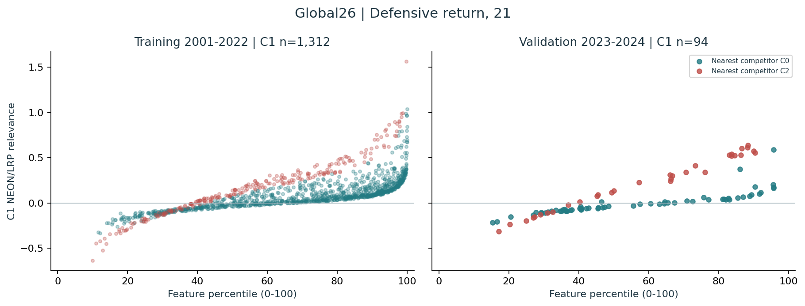

Feature: msci_defensive_absolute_return21. Low/high quartiles are formed within each validation C1 feature distribution; other inputs vary.

**Axes**: Display percentile against all 5,391 training values; actual return enters the model. Each dot is an assigned-C1 date. Left n=1312, right n=94. Shared vertical scale. Color identifies the nearest competitor.

**Observed role**: Mean absolute relevance: training 0.158, validation 0.164 (rank 16/26). Validation signed mean +0.072; 51.1% of dates support C1. Low/high percentile-quartile median relevance: -0.108/+0.288.

**Interpretation**: The actual 21-session simple return enters the model. The horizontal percentile is a display conversion against training values, preserving the order of observed returns. Closest input overlap: Cyclical - Defensive, 21, rho -0.638 on this C1 sample.

## Global26 / Japan return, 21

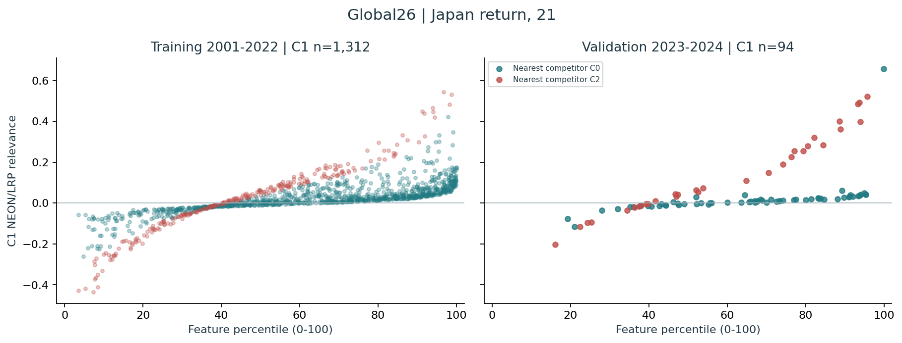

Feature: msci_japan_absolute_return21. Low/high quartiles are formed within each validation C1 feature distribution; other inputs vary.

**Axes**: Display percentile against all 5,391 training values; actual return enters the model. Each dot is an assigned-C1 date. Left n=1312, right n=94. Shared vertical scale. Color identifies the nearest competitor.

**Observed role**: Mean absolute relevance: training 0.064, validation 0.081 (rank 20/26). Validation signed mean +0.059; 69.1% of dates support C1. Low/high percentile-quartile median relevance: -0.017/+0.042.

**Interpretation**: The actual 21-session simple return enters the model. The horizontal percentile is a display conversion against training values, preserving the order of observed returns. Closest input overlap: Cyclical return, 21, rho 0.592 on this C1 sample.

## Global26 / EM return, 21

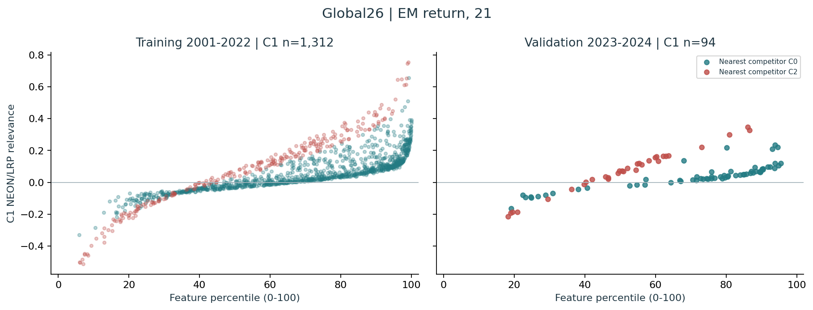

Feature: msci_em_absolute_return21. Low/high quartiles are formed within each validation C1 feature distribution; other inputs vary.

**Axes**: Display percentile against all 5,391 training values; actual return enters the model. Each dot is an assigned-C1 date. Left n=1312, right n=94. Shared vertical scale. Color identifies the nearest competitor.

**Observed role**: Mean absolute relevance: training 0.115, validation 0.089 (rank 19/26). Validation signed mean +0.050; 77.7% of dates support C1. Low/high percentile-quartile median relevance: -0.074/+0.087.

**Interpretation**: The actual 21-session simple return enters the model. The horizontal percentile is a display conversion against training values, preserving the order of observed returns. Closest input overlap: EM - USA, 21, rho 0.773 on this C1 sample.

## Global26 / EMU return, 21

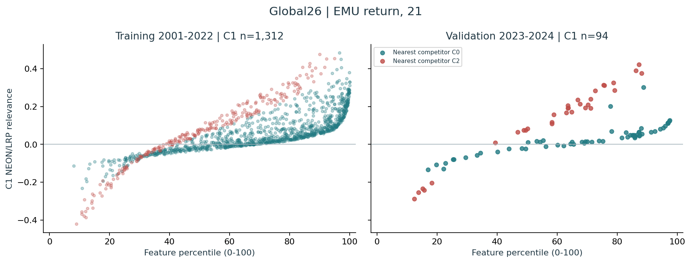

Feature: msci_emu_absolute_return21. Low/high quartiles are formed within each validation C1 feature distribution; other inputs vary.

**Axes**: Display percentile against all 5,391 training values; actual return enters the model. Each dot is an assigned-C1 date. Left n=1312, right n=94. Shared vertical scale. Color identifies the nearest competitor.

**Observed role**: Mean absolute relevance: training 0.099, validation 0.112 (rank 18/26). Validation signed mean +0.066; 77.7% of dates support C1. Low/high percentile-quartile median relevance: -0.064/+0.086.

**Interpretation**: The actual 21-session simple return enters the model. The horizontal percentile is a display conversion against training values, preserving the order of observed returns. Closest input overlap: VSTOXX, rho -0.587 on this C1 sample.

## Global26 / Cyclical return, 5

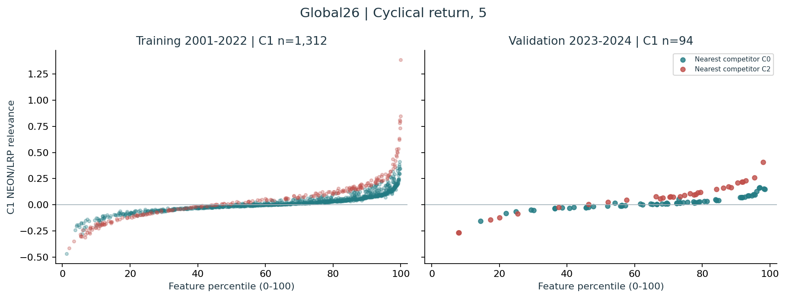

Feature: msci_cyclical_absolute_return5. Low/high quartiles are formed within each validation C1 feature distribution; other inputs vary.

**Axes**: Display percentile against all 5,391 training values; actual return enters the model. Each dot is an assigned-C1 date. Left n=1312, right n=94. Shared vertical scale. Color identifies the nearest competitor.

**Observed role**: Mean absolute relevance: training 0.084, validation 0.076 (rank 21/26). Validation signed mean +0.042; 73.4% of dates support C1. Low/high percentile-quartile median relevance: -0.032/+0.151.

**Interpretation**: The actual 5-session simple return enters the model. The horizontal percentile is a display conversion against training values, preserving the order of observed returns. Closest input overlap: EMU return, 5, rho 0.692 on this C1 sample.

## Global26 / Defensive return, 5

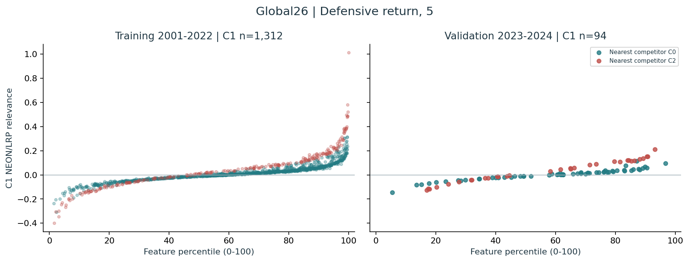

Feature: msci_defensive_absolute_return5. Low/high quartiles are formed within each validation C1 feature distribution; other inputs vary.

**Axes**: Display percentile against all 5,391 training values; actual return enters the model. Each dot is an assigned-C1 date. Left n=1312, right n=94. Shared vertical scale. Color identifies the nearest competitor.

**Observed role**: Mean absolute relevance: training 0.068, validation 0.050 (rank 23/26). Validation signed mean +0.015; 61.7% of dates support C1. Low/high percentile-quartile median relevance: -0.051/+0.102.

**Interpretation**: The actual 5-session simple return enters the model. The horizontal percentile is a display conversion against training values, preserving the order of observed returns. Closest input overlap: EMU return, 5, rho 0.568 on this C1 sample.

## Global26 / Japan return, 5

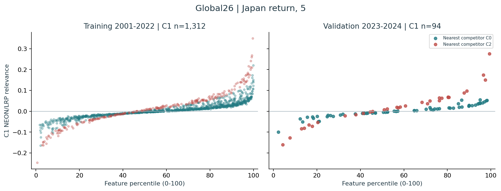

Feature: msci_japan_absolute_return5. Low/high quartiles are formed within each validation C1 feature distribution; other inputs vary.

**Axes**: Display percentile against all 5,391 training values; actual return enters the model. Each dot is an assigned-C1 date. Left n=1312, right n=94. Shared vertical scale. Color identifies the nearest competitor.

**Observed role**: Mean absolute relevance: training 0.034, validation 0.037 (rank 26/26). Validation signed mean +0.010; 56.4% of dates support C1. Low/high percentile-quartile median relevance: -0.034/+0.039.

**Interpretation**: The actual 5-session simple return enters the model. The horizontal percentile is a display conversion against training values, preserving the order of observed returns. Closest input overlap: Cyclical return, 5, rho 0.545 on this C1 sample.

## Global26 / EM return, 5

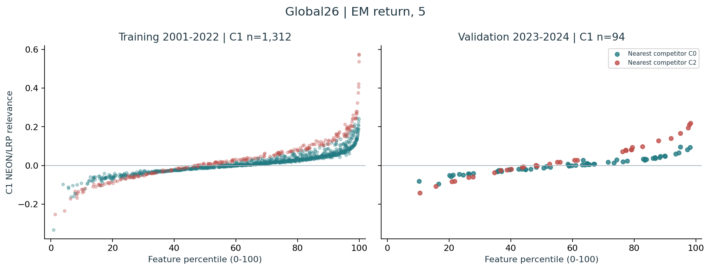

Feature: msci_em_absolute_return5. Low/high quartiles are formed within each validation C1 feature distribution; other inputs vary.

**Axes**: Display percentile against all 5,391 training values; actual return enters the model. Each dot is an assigned-C1 date. Left n=1312, right n=94. Shared vertical scale. Color identifies the nearest competitor.

**Observed role**: Mean absolute relevance: training 0.052, validation 0.046 (rank 24/26). Validation signed mean +0.014; 56.4% of dates support C1. Low/high percentile-quartile median relevance: -0.047/+0.055.

**Interpretation**: The actual 5-session simple return enters the model. The horizontal percentile is a display conversion against training values, preserving the order of observed returns. Closest input overlap: EMU return, 5, rho 0.710 on this C1 sample.

## Global26 / EMU return, 5

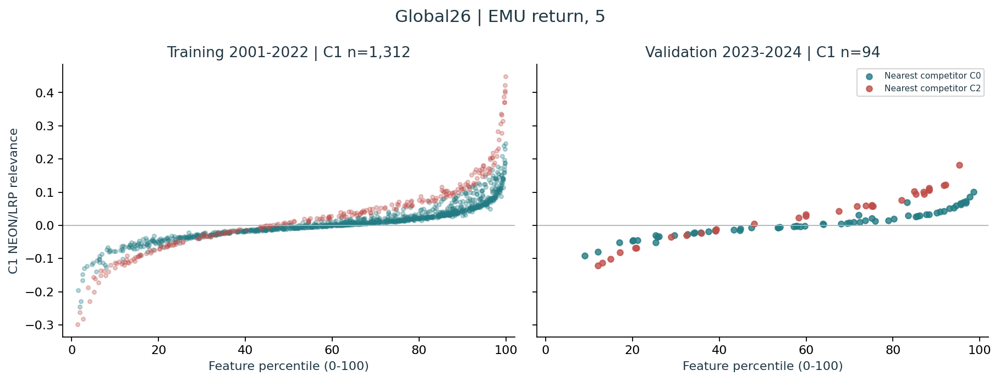

Feature: msci_emu_absolute_return5. Low/high quartiles are formed within each validation C1 feature distribution; other inputs vary.

**Axes**: Display percentile against all 5,391 training values; actual return enters the model. Each dot is an assigned-C1 date. Left n=1312, right n=94. Shared vertical scale. Color identifies the nearest competitor.

**Observed role**: Mean absolute relevance: training 0.049, validation 0.046 (rank 25/26). Validation signed mean +0.016; 57.4% of dates support C1. Low/high percentile-quartile median relevance: -0.044/+0.069.

**Interpretation**: The actual 5-session simple return enters the model. The horizontal percentile is a display conversion against training values, preserving the order of observed returns. Closest input overlap: EM return, 5, rho 0.710 on this C1 sample.

## Feature inventory

| # | Exact identifier | Operator recipe | Squared weight |
| --- | --- | --- | --- |
| 1 | rank252__return__sp500__21d | rank252(return(sp500, 21)) | 0.250000 |
| 2 | rank252__return__nasdaq100__21d | rank252(return(nasdaq100, 21)) | 0.250000 |
| 3 | rank252__return__russell2000__21d | rank252(return(russell2000, 21)) | 0.250000 |
| 4 | rank252__return__ftse100__21d | rank252(return(ftse100, 21)) | 0.250000 |
| 5 | rank252__realized_vol__sp500__21d | rank252(volatility(sp500, 21)) | 0.200000 |
| 6 | rank252__realized_vol__nasdaq100__21d | rank252(volatility(nasdaq100, 21)) | 0.200000 |
| 7 | rank252__realized_vol__russell2000__21d | rank252(volatility(russell2000, 21)) | 0.200000 |
| 8 | rank252__level__vix | rank252(level(vix)) | 0.200000 |
| 9 | rank252__level__vstoxx | rank252(level(vstoxx)) | 0.200000 |
| 10 | rank252__corr__sp500__nasdaq100__21d | rank252(correlation(sp500, nasdaq100, 21)) | 0.333333 |
| 11 | rank252__corr__sp500__russell2000__21d | rank252(correlation(sp500, russell2000, 21)) | 0.333333 |
| 12 | rank252__corr__nasdaq100__russell2000__21d | rank252(correlation(nasdaq100, russell2000, 21)) | 0.333333 |
| 13 | rank252__msci_cyc_minus_def_return21 | rank252(spread(msci_cyclical, msci_defensive, 21)) | 0.333333 |
| 14 | rank252__msci_em_minus_us_return21 | rank252(spread(msci_em, msci_us, 21)) | 0.166667 |
| 15 | rank252__msci_japan_minus_emu_return21 | rank252(spread(msci_japan, msci_emu, 21)) | 0.166667 |
| 16 | rank252__msci_country_pc1share63 | rank252(pc1_share(msci_us, msci_uk, msci_japan, msci_canada, msci_australia, msci_germany, msci_france, msci_switzerland, 63)) | 0.333333 |
| 17 | msci_cyclical_absolute_return21 | return(msci_cyclical, 21) | 0.250000 |
| 18 | msci_defensive_absolute_return21 | return(msci_defensive, 21) | 0.250000 |
| 19 | msci_japan_absolute_return21 | return(msci_japan, 21) | 0.166667 |
| 20 | msci_em_absolute_return21 | return(msci_em, 21) | 0.166667 |
| 21 | msci_emu_absolute_return21 | return(msci_emu, 21) | 0.166667 |
| 22 | msci_cyclical_absolute_return5 | return(msci_cyclical, 5) | 0.125000 |
| 23 | msci_defensive_absolute_return5 | return(msci_defensive, 5) | 0.125000 |
| 24 | msci_japan_absolute_return5 | return(msci_japan, 5) | 0.083333 |
| 25 | msci_em_absolute_return5 | return(msci_em, 5) | 0.083333 |
| 26 | msci_emu_absolute_return5 | return(msci_emu, 5) | 0.083333 |

## Sources and operations

- [NEON original paper](https://arxiv.org/html/1906.07633v2#S2)
- [FMP stable historical EOD](https://site.financialmodelingprep.com/developer/docs/stable/historical-price-eod-full)
- [Cboe VIX daily data](https://cdn-api.cboe.com/api/global/us_indices/daily_prices/VIX_History.csv)
- [STOXX V2TX daily data](https://www.stoxx.com/document/Indices/Current/HistoricalData/h_v2tx.txt)
- [API and operations](../API.md)
- [Version policy](../VERSIONING.md)
- [Validation evidence](../validation/replay.json)
